# Sell Liferay and Services Through Digital Sales Rooms
{: .no_toc }

1. TOC
{:toc}

## What You'll Build

*Northwind Digital* is a fictional Liferay partner. It sells Liferay DXP subscriptions and its own professional services, and it runs **every deal through a Digital Sales Room** (DSR). A DSR is a private, branded workspace in Liferay that the seller and the buyer's team share. You start from a plain, running **Liferay DXP 2026.Q4** and add:

| Piece | What it does | Liferay feature |
| --- | --- | --- |
| Partner website and collateral | Public site, and the briefs, services catalogue and case studies behind it | Sites, **new CMS** |
| A pipeline of rooms | One room per prospect: new logo, upgrade, RFP, public tender, renewal, reignited and lost deals, each with a trend from *Cold* to *Closed Won* | **Digital Sales Room**, Accounts |
| Room templates per deal type | *New logo evaluation*, *RFP and security review*, *Renewal and expansion*, *Self-service estimate*, *Customer onboarding* | Site Templates |
| Automatic room setup | A new room gets its template's pages and a welcome addressed to the buyer by name | **Object Action** on the DSR Room object, and a small microservice |
| Public project estimator | A prospect sizes a project on the website. When signed in, they save it into their own room | Content page, the same microservice |
| English and Japanese | Site, templates, rooms and estimate PDFs in both languages, and a user who signs in to a Japanese UI | Localization |
| Salesforce opportunity panel | Shows the linked opportunity in every room and writes room trend changes back | **Custom element client extension**, Object Action |
| Buyer engagement analytics | Who opened which document, how often, and when | DSR analytics on Liferay Data Platform |
| AI access (optional) | An AI assistant can ask about a deal or draft content in the CMS | **MCP server** |

[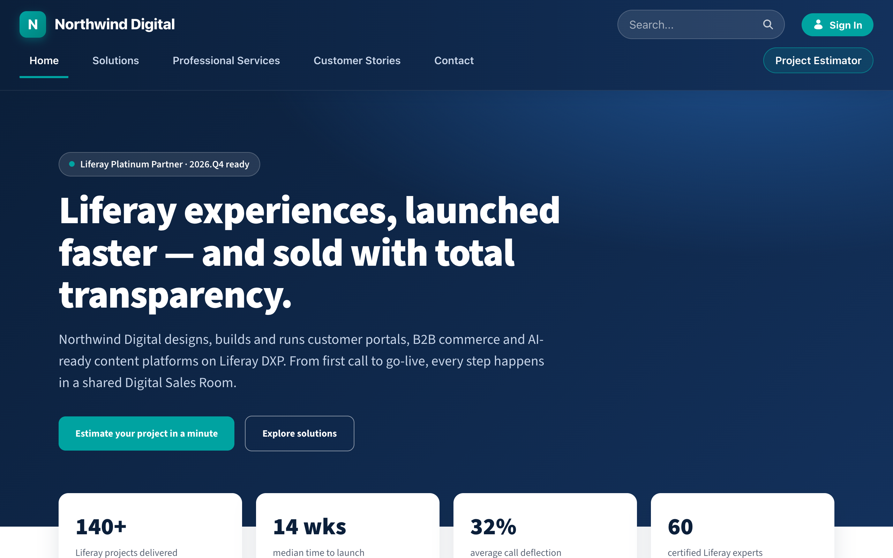{: .screenshot }](partner-site.png)

## Ingredients

| Ingredient | Type | Guide |
| --- | --- | --- |
| Liferay DXP **2026.Q4**, running (bundle or Docker) | Platform | [Starting with a Docker Image](https://learn.liferay.com/w/dxp/getting-started/starting-with-a-docker-image) |
| Digital Sales Room app for 2026.Q4 (`.lpkg`) and its activation key (`.xml`) | Marketplace app | [Activating Digital Sales Room](https://learn.liferay.com/w/digital-sales-room/activating-digital-sales-room) |
| Accounts, Site Templates, Objects | Built-in | [Accounts](https://learn.liferay.com/w/dxp/users-and-permissions/accounts) |
| Client extensions (custom element) | Built-in | [Client Extensions](https://learn.liferay.com/w/dxp/liferay-development/client-extensions) |
| A small automation service (any language; the demo uses about 300 lines of Python) | Microservice | This recipe, steps 5, 9 and 11 |
| Liferay Data Platform (Analytics Cloud) connection | Analytics | [Engagement Metrics Dashboard](https://learn.liferay.com/w/digital-sales-room/engagement-metrics-dashboard) |
| An AI assistant that speaks MCP (optional) | AI | [Model Context Protocol](https://modelcontextprotocol.io) |

**Before you start, you need:**

- Liferay DXP 2026.Q4, running, and an administrator who can sign in.
- The DSR `.lpkg` **built for 2026.Q4** and its activation key. DSR is a separate Marketplace purchase. Ask your Liferay account manager, or open the Products Catalog in One Liferay.
- Somewhere to run the automation service that Liferay can reach, for example a container next to Liferay or a client-extension microservice on Liferay SaaS.

Everything on this page was built and captured on Liferay DXP 2026.Q4 in Docker. All companies, people and prices are fictional. The analytics come from a mock Liferay Data Platform that serves sample engagement data, and the Salesforce panel reads a mock API.

{: .important }
Use the DSR build that matches your DXP release. On 2026.Q4, the 2026.Q3 Marketplace build fails with *Only allowed bundles can add system object fields*. You then get an empty DSR site and no Room object.

## Steps

### Step 1: Activate Digital Sales Room on 2026.Q4

1. Copy the DSR activation key (`.xml`) and the DSR `.lpkg` files to `[Liferay Home]/deploy`. In Docker, that is `/opt/liferay/deploy`.
1. Wait until the DSR modules report `STARTED`. On a brand-new database, the DSR bundles can check their license before the key is processed and then stop, so **restart Liferay once** after the first start.
1. Wait for `Server startup in` in the log **before** you open any page. Liferay creates the DSR site (and the CMS site) on the first HTTP request. A request that arrives during startup creates them empty.
1. Open the **Global Menu** → **Commerce** → **Digital Sales Room Management**. The launchpad has **Home**, **Rooms** and **Analytics**.

[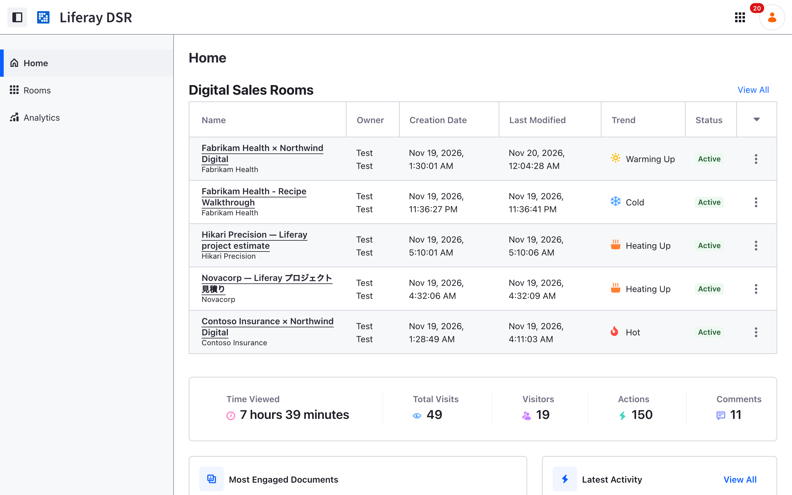{: .screenshot }](dsr-home.png)

Add the switches the later steps need to `portal-ext.properties`, then restart:

```properties
# Step 10: English and Japanese
locales.enabled=en_US,ja_JP

# Step 12 (optional): MCP server admin UI
feature.flag.LPD-63311=true

# Self-hosted only, when your analytics endpoint is not a Liferay host
# analytics.cloud.domain.allowed=*
```

### Step 2: Publish the partner site and its collateral

The new CMS ships with 2026.Q4, with no flag needed.

1. Open the **Global Menu** → **CMS** and create a Space, for example **Sales Enablement**. Connect it to your public site.
1. Add the material your sellers reuse in every deal: solution briefs, a professional services catalogue and case studies. Add them in English and Japanese.
1. Build the public site from fragments: **Home**, **Solutions**, **Professional Services**, **Customer Stories**, **Contact**, plus a **Project Estimator** page for step 9.

[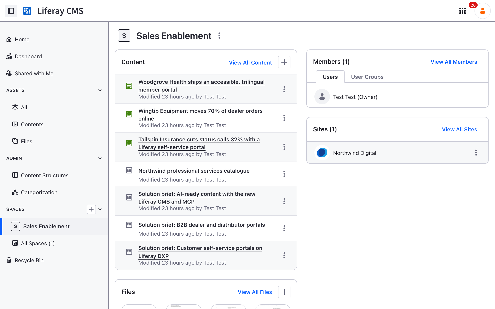{: .screenshot }](cms-space.png)

One source then feeds the website, the rooms and, through MCP, AI assistants.

### Step 3: Add the prospects and the seller team

A room belongs to an **account**, and the account sets who you can invite.

1. Under **Global Menu** → **Applications** → **Accounts**, add one *Business* account per prospect, such as *Contoso Insurance*, *Globex Manufacturing*, *Fabrikam Health* and *Woodgrove Bank*. Add each buyer contact (sponsor, IT lead, procurement) to its account.
1. Add the seller team as users: an account executive, a solutions architect, a delivery lead and a sales director. Give them the **DSR Seller** role, which the DSR app creates.

### Step 4: Build a room template for each deal type

The **Create New Digital Sales Room** wizard lists **every Site Template** in the instance, next to the default *DSR* template. So each kind of deal can start from its own template:

| Template (EN / JA) | Pages it adds |
| --- | --- |
| New logo evaluation / 新規導入の評価 | Mutual action plan, Solution, FAQ |
| RFP and security review / RFP・セキュリティ審査 | Evaluation timeline, Security and compliance, Q&A log |
| Renewal and expansion / 契約更新・拡張 | Success review, Roadmap, Expansion options |
| Self-service estimate / セルフサービス見積り | Estimate (filled by the estimator in step 9) |
| Customer onboarding / 導入オンボーディング | Project plan, Project team, Onboarding FAQ |

To make one, go to **Control Panel** → **Sites** → **Site Templates**. Start from a copy of the *DSR* template (export it and import it into the new template), so you keep its fragments, theme and **DSR master page**. Give the template and its pages names in both languages.

{: .note }
2026.Q4.0 traps found while building this:
(1) A template without the `digital-sales-room-master` master page produces rooms that render empty.
(2) DSR copies a template into a new room from an export taken as the Guest user, so a template page without Guest VIEW is silently left out. Step 5 removes that Guest VIEW again inside each room.
(3) Avoid `&` and `'` in template names and descriptions, because the wizard shows them escaped (`&amp;`).

### Step 5: Set up each new room automatically with an Object Action

DSR rooms are records of the **Room** object (`L_DSR_ROOM`). An **Object Action** on that object runs whenever a room is created, whether from the wizard, the API or the estimator.

1. Go to **Control Panel** → **Objects** → **Room** → **Actions** and click **Add Object Action**.
1. **Basic Info:** name it *Apply Northwind template pages*.
1. **Action Builder:** choose **When** *On After Add* and **Then** *Webhook*. Set the URL of your automation service. For a service on your local network, turn on **Allow Local Network Access** and list its host under **Hosts Allowed**.

[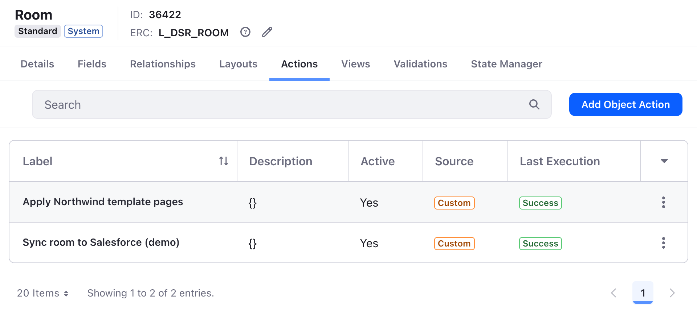{: .screenshot }](object-actions.png)

[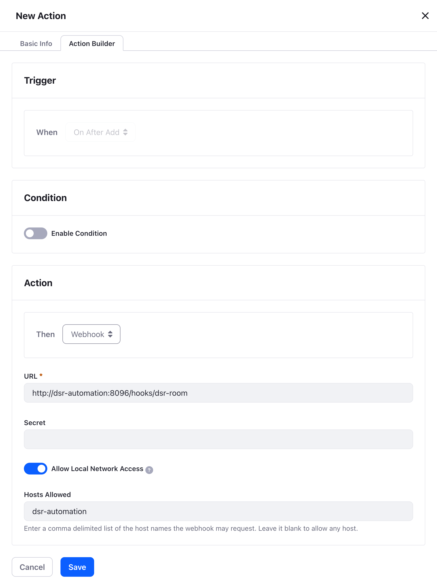{: .screenshot }](object-action-webhook.png)

When it receives the webhook, the service does the following:

1. It waits until the room reports `initialized` (`GET /o/digital-sales-room/rooms/by-external-reference-code/{erc}`).
1. It adds the template's pages to the room site with `headless-admin-site` (`/o/headless-admin-site/v1.0/sites/{site}/site-pages`).
1. It replaces the placeholder welcome card with one addressed to the account, signed by the account executive.
1. It **gives every room page except Login the Onboarding page's permissions, without Guest.** Skip this and guests can read pages such as the mutual action plan through the room URL, because of trap 2 in step 4.

{: .tip }
In 2026.Q4.0, DSR blocks placed through `headless-admin-site` save but do not render. Basic HTML fragments do, so the demo renders its template pages as HTML styled like the DSR blocks. They take `value_i18n`, which makes them bilingual.

### Step 6: Create the rooms

1. In the launchpad, open **Rooms** → **New Digital Sales Room**.
1. **Account Association:** pick the prospect's account.

   [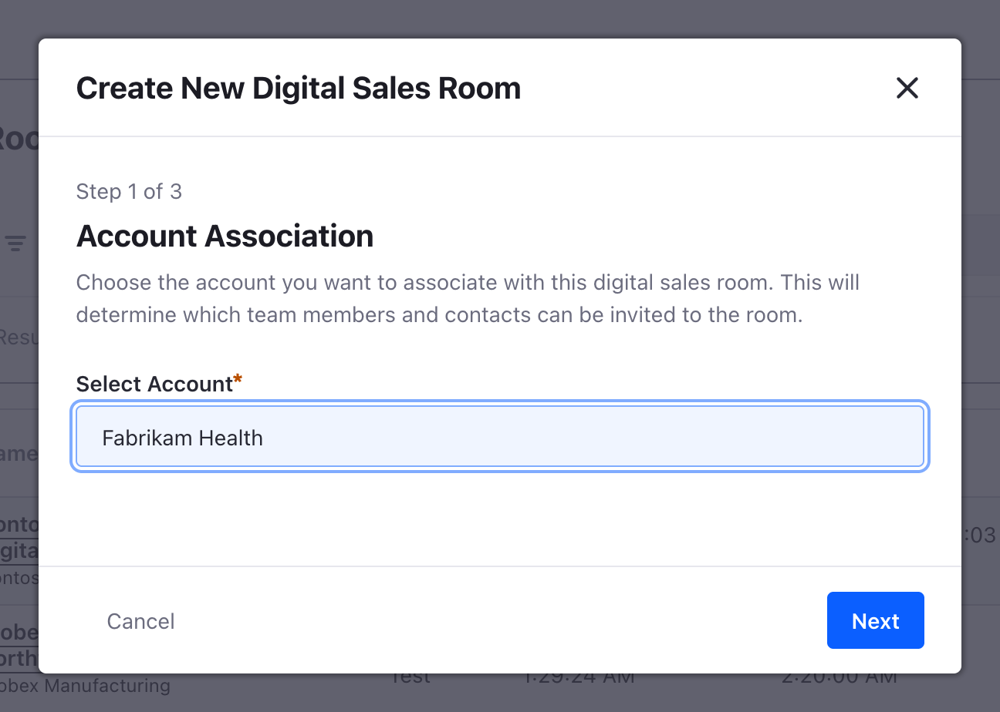{: .screenshot }](wizard-1-account.png)

1. **Choose a Template:** pick the deal type. The preview shows the pages the room starts with.

   [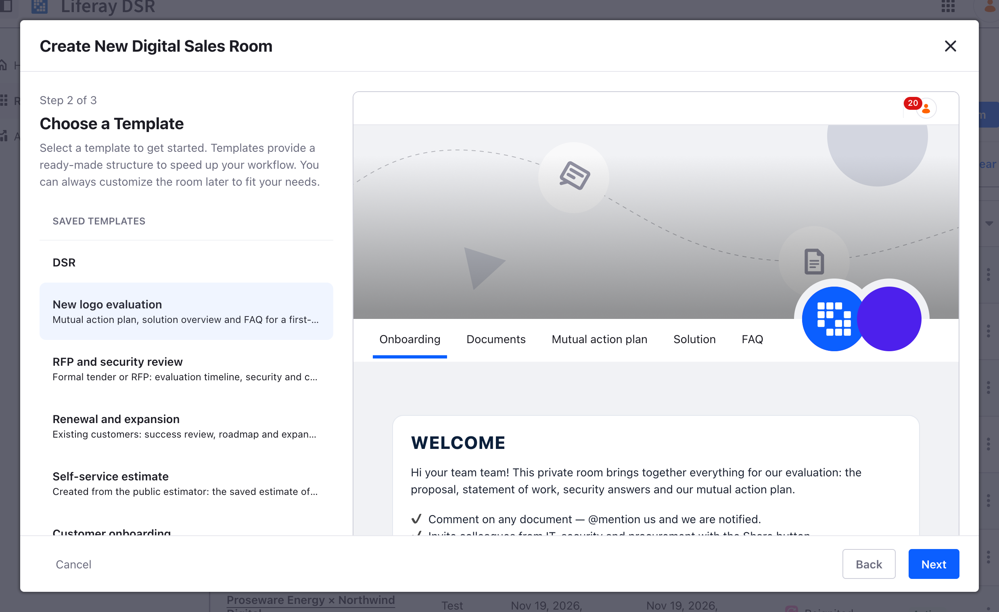{: .screenshot }](wizard-2-template.png)

1. **Name Your Room:** give it a name the buyer recognizes and set a short **Friendly URL**. If you skip it, the URL comes from the account name and can clash with the account's own site, ending up as something like `/contoso-insurance-1`.

   [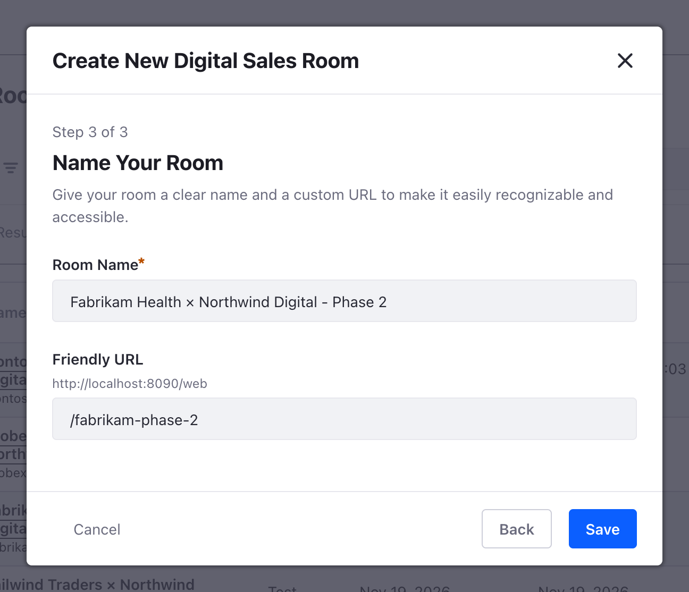{: .screenshot }](wizard-3-name.png)

1. Click **Save**. The room opens in the page editor, where you can tailor it before you invite anyone.

   [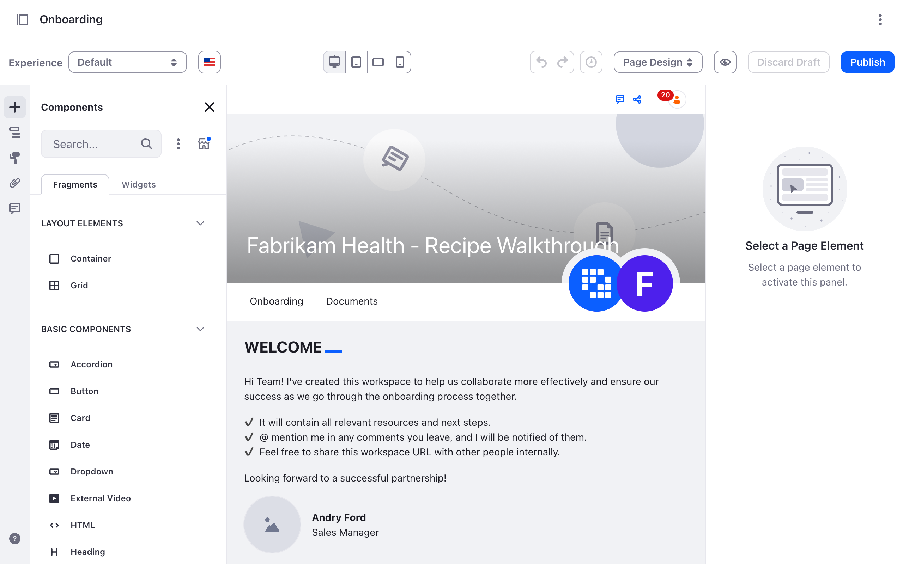{: .screenshot }](room-editor.png)

Seconds later, the object action has added the template pages and the personal welcome:

[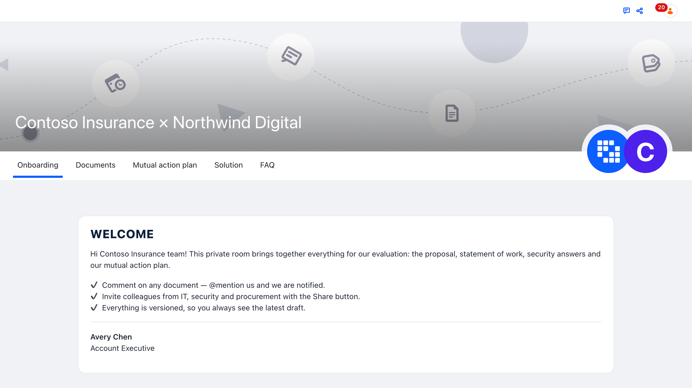{: .screenshot }](template-room-onboarding.png)

The demo uses one room for each kind of story a partner meets:

| Room | Use case | Trend |
| --- | --- | --- |
| Contoso Insurance | New logo: customer portal | Hot |
| Globex Manufacturing | New logo: B2B commerce | Engaged |
| Fabrikam Health | New logo: early discovery | Warming Up |
| Tailwind Traders | Existing customer: upgrade to 2026.Q4, plus commerce | Ready to Close |
| Woodgrove Bank | Regulated industry: RFP response with compliance matrix | Heating Up |
| City of Lakeside | Public sector: tender with accessibility conformance report | Engaged |
| Litware Software | Renewal plus managed services upsell | Closed Won |
| Adventure Works University | Lost deal: archived room with loss review | Closed Lost |
| Proseware Energy | Reignited opportunity: ROI model and reference architecture | Reignited |
| Lucerne Publishing | AI-ready content: new CMS and MCP | Cold |

[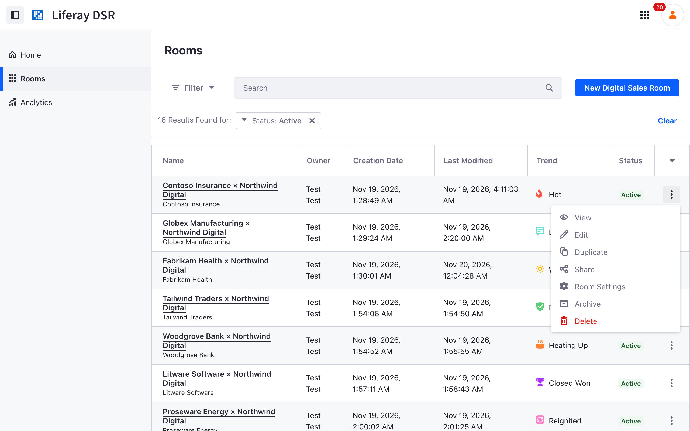{: .screenshot }](room-actions.png)

### Step 7: Work the deal inside the room

**Documents.** Upload the deal's proposal, draft SOW and mutual action plan, plus shared collateral such as the security overview, under **Documents**. Each document stays inside its room, and every preview and download counts in the analytics. ([Managing Room Documents](https://learn.liferay.com/w/digital-sales-room/managing-room-documents))

[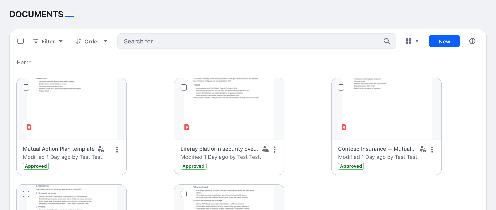{: .screenshot }](room-documents.png)

**Invite by role, with an end date.** Click **Share**, enter emails, pick a role and optionally set **Access Valid Until**. Access then ends at the end of that day (UTC). Invitations are valid for 48 hours.

| Who | Role |
| --- | --- |
| Deal owner, buyer champion, economic buyer | **Room Collaborator**: manage pages and documents, comment, share |
| Solutions architect, delivery lead | **Content Contributor**: view, comment, upload, share |
| Other buyers, outside advisors | **Viewer**: view and comment |

[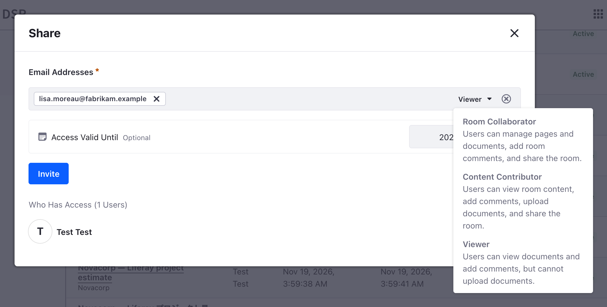{: .screenshot }](share-roles.png)

**Comments.** Use the speech-bubble icon in the room header for questions and answers, with @mentions, so they stay out of email. ([Room Comments](https://learn.liferay.com/w/digital-sales-room/room-comments))

[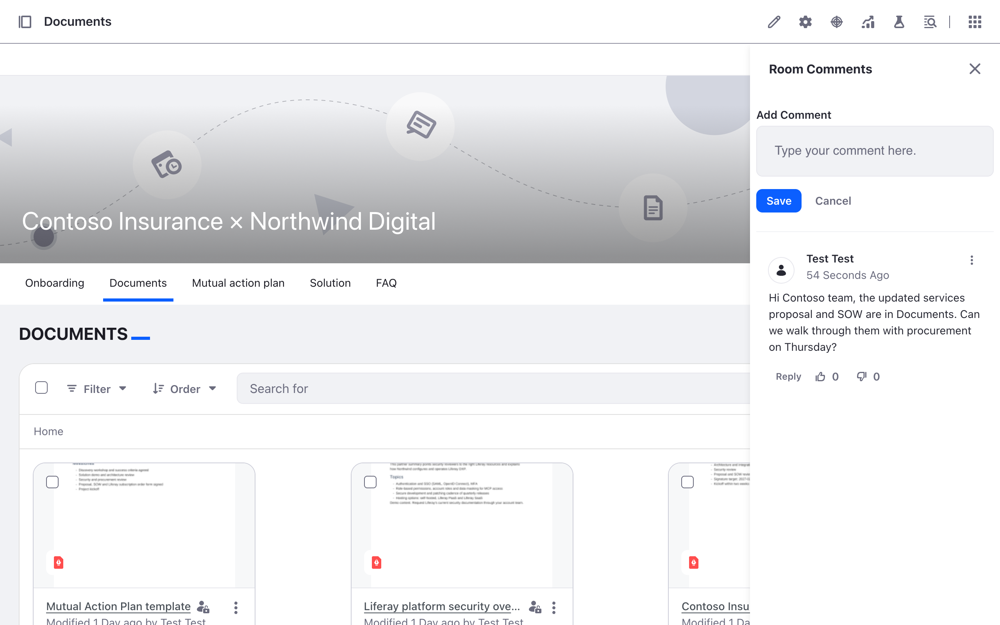{: .screenshot }](room-comments.png)

**Close it out.** When a deal is lost, set the trend to *Closed Lost* and **Archive** the room. Archiving can be undone. It makes the room read-only for buyers and keeps the history for the loss review. **Duplicate** copies the pages and the documents you choose into a new room, without comments or members.

### Step 8: Follow buyer engagement

Connect the instance to **Liferay Data Platform**: **Instance Settings** → **Analytics Cloud**, paste the token. The DSR **Analytics** page then shows time viewed, visits, visitors, actions and comments, the most active visitors and the latest activity. You can see them across all rooms or for one room.

[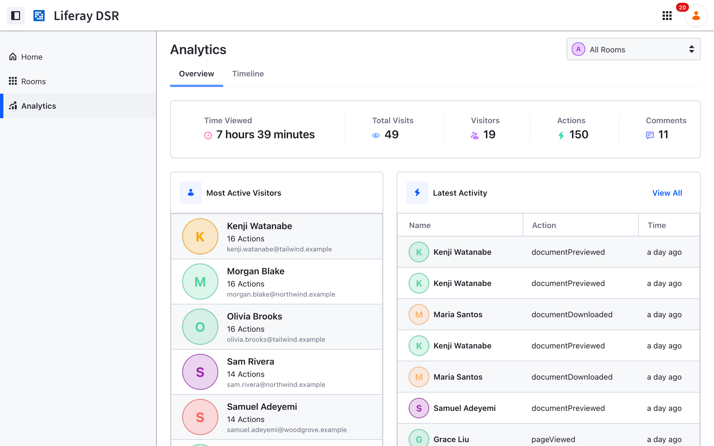{: .screenshot }](analytics-overview.png)

Select a room to see its own numbers, and set its **Room Trend** as the deal moves. The trend has nine values, from *Cold* through *Heating Up*, *Hot* and *Ready to Close* to *Closed Won*, *Closed Lost* or *Reignited*.

[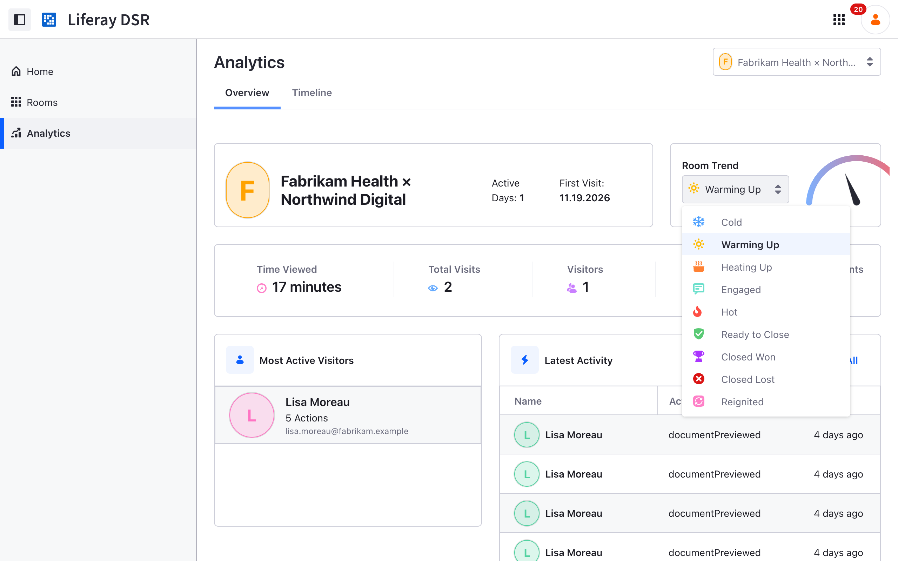{: .screenshot }](analytics-room-trend.png)

The **Timeline** tab charts engagement over time and can be filtered by date and user. Use it to spot when a quiet deal comes back to life. ([Engagement Metrics Dashboard](https://learn.liferay.com/w/digital-sales-room/engagement-metrics-dashboard))

[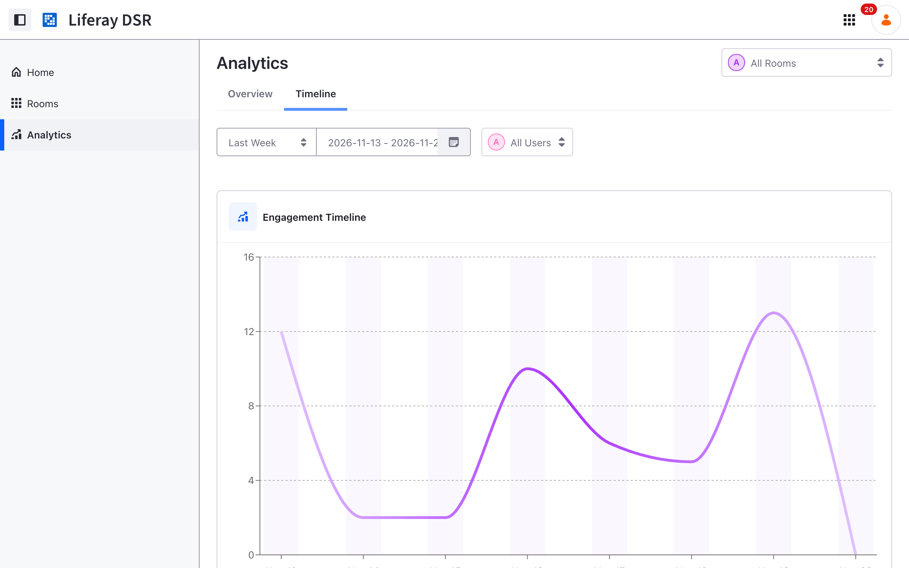{: .screenshot }](analytics-timeline.png)

### Step 9: Let prospects save an estimate from the public site into a room

The **Project Estimator** page on the public site lets a prospect pick what they are building (customer portal, B2B commerce, and so on), the number of users, integrations, languages and hosting. They see the weeks, a services range and a recommended package at once.

[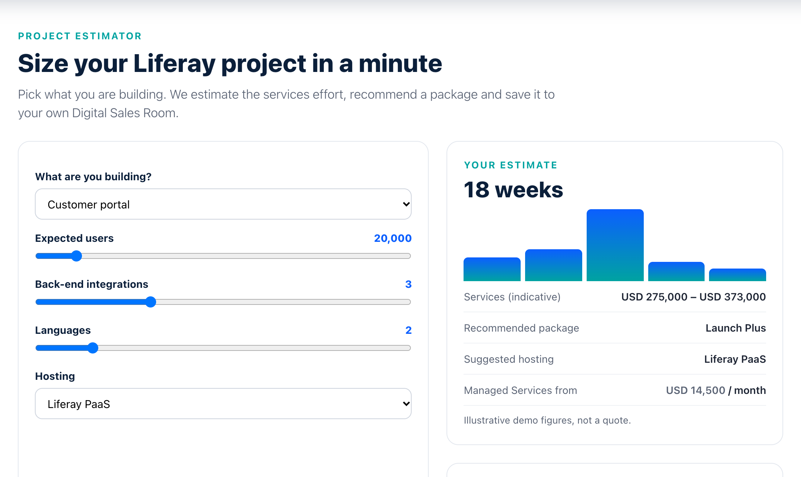{: .screenshot }](estimator.png)

**Saving is for signed-in users only.** Guests see **Sign in to save**, which brings them back to the estimator after they sign in. Signed-in users see **Save to my Digital Sales Room**.

[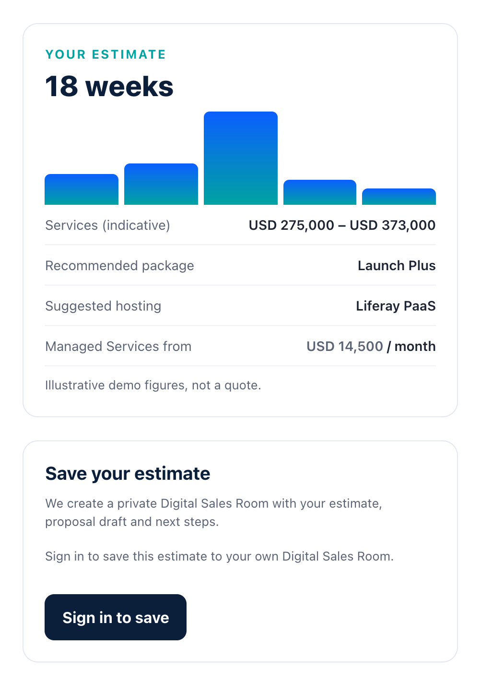{: .screenshot }](estimator-guest-save.png)

When the user clicks save, the page posts the estimate to the automation service with the user's Liferay session cookie and `Liferay.authToken`. The service never trusts the browser. It asks Liferay who the caller is, and refuses guests, expired sessions and forged calls:

```python
# Ask Liferay who the caller is, with the caller's own session.
data = urlencode({"cmd": json.dumps({"/user/get-current-user": {}}),
                  "p_auth": csrf_token}).encode()
req = Request(LIFERAY + "/api/jsonws/invoke", data=data,
              headers={"Cookie": cookie, "X-CSRF-Token": csrf_token})
user = json.load(urlopen(req))
if not user.get("emailAddress") or user.get("defaultUser") or user.get("guestUser"):
    return 401
```

Then it does the following:

1. It creates or reuses the prospect's account and adds the signed-in user as the buyer.
1. It creates a room from the **Self-service estimate** template (`POST /o/digital-sales-room/rooms`, with a friendly URL).
1. It writes the saved estimate into the room's **Estimate** page, where buyer and seller can rework it together.
1. It uploads an estimate PDF and invites the buyer and the account executive as Room Collaborators.

{: .note }
In 2026.Q4.0, posting room comments through REST throws `UnsupportedOperationException`, because room comments go through the DSR portlet. The demo comments on the estimate PDF instead.

### Step 10: Make it work in Japanese

1. With `locales.enabled=en_US,ja_JP` set (step 1), add `/ja/` to any URL to see the Japanese version.
1. Give pages, fragments, CMS content and template pages Japanese values. Object fields take `ja_JP`, and fragments take `value_i18n`.
1. Generate estimate PDFs in the language the user saved from. Japanese PDFs need a CJK font. The demo uses an Adobe-Japan1 CID font.
1. For a Japanese-speaking buyer or seller, set the user's **Language** to Japanese. They then sign in to a Japanese UI, DSR launchpad included.

[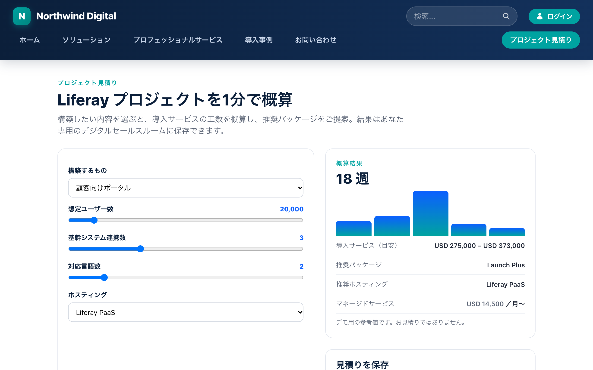{: .screenshot }](estimator-ja.png)

[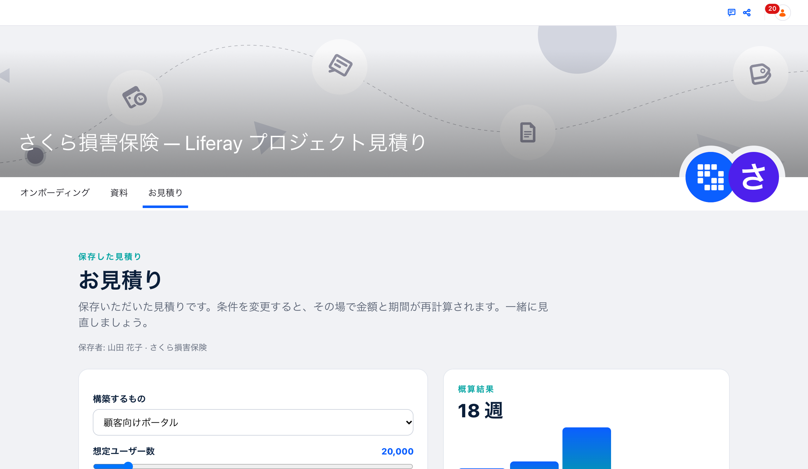{: .screenshot }](estimate-room-ja.png)

### Step 11: Show the Salesforce opportunity in every room, and write back

Sellers live in their CRM, so every room shows the linked Salesforce opportunity: stage, amount, close date, owner, probability and next step. It is a **custom element client extension** (`<nw-salesforce-panel>`) that the template places on the Onboarding page:

```yaml
salesforce-connector:
    name: Salesforce Opportunity (demo)
    type: customElement
    htmlElementName: nw-salesforce-panel
    friendlyURLMapping: salesforce-connector
    instanceable: false
    portletCategoryName: category.client-extensions
    urls:
        - salesforce-panel.js
    useESM: false
```

Deploy it from a Liferay Workspace with `blade gw deploy`. Alternatively, register it with a `CETConfiguration` OSGi config in `osgi/configs/` that points `baseURL` at wherever the JavaScript is hosted. The element reads the room's site ID and calls the service, which answers from the CRM.

[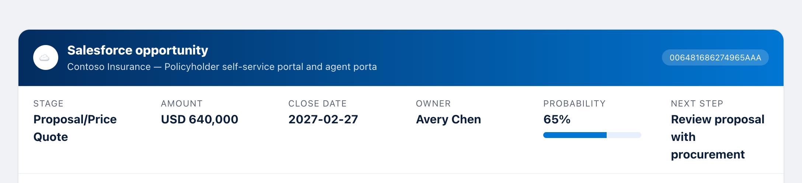{: .screenshot }](salesforce-panel.png)

**Write-back.** Add a second object action on the Room object: **On After Update** → **Webhook** to the same service. When a seller changes the Room Trend (step 8), the service maps it to an opportunity stage and updates the opportunity:

| Room Trend | Opportunity stage |
| --- | --- |
| Cold / Warming Up / Heating Up | Prospecting / Qualification / Needs Analysis |
| Engaged / Hot | Value Proposition / Proposal/Price Quote |
| Ready to Close | Negotiation/Review |
| Closed Won / Closed Lost | Closed Won / Closed Lost |
| Room archived | Closed Lost |

[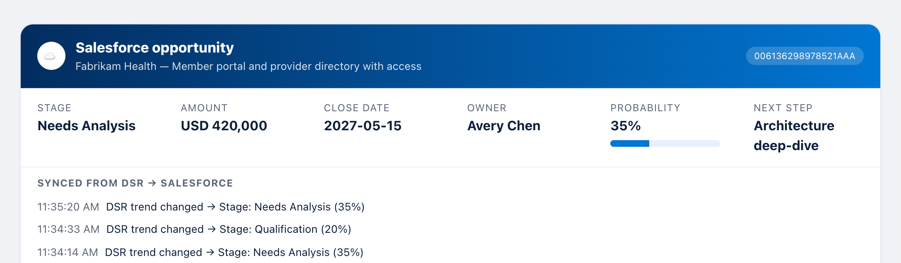{: .screenshot }](salesforce-writeback.png)

{: .important }
The connector in the screenshots is **fictitious**: a mock API stands in for Salesforce. For a real connection, point the service at Salesforce's REST API with OAuth (for example as an OAuth-protected client-extension microservice), and keep the credentials in the service, never in the browser.

### Step 12 (optional): Let AI assistants work with the deal through MCP

2026.Q4 includes an **MCP server**. The `LPD-63311` flag (step 1) only shows its admin UI. To switch the endpoint on, also add an OSGi config, `com.liferay.mcp.server.rest.internal.configuration.MCPServerConfiguration.config`:

```properties
enabled=B"true"
```

Connect an AI assistant to `https://<your-host>/o/mcp`. Then ask it, for example, *"What's open in the Contoso deal?"* or *"Draft a solution brief for B2B portals in the Sales Enablement Space."* Control what it can see with MCP profiles and data masks under **Control Panel** → **MCP Server**. It works with the permissions of the user it signs in as.

## Result

From a plain DXP 2026.Q4, you have a partner sales platform where:

- the public site and the new CMS give buyers and sellers the same collateral,
- every deal has a Digital Sales Room built from a template for its deal type, set up automatically with its own pages and a personal welcome,
- buyers are invited by role, with access that ends when you say, and talk to the seller in room comments,
- a prospect can size a project on the website and save it into their own room, in English or Japanese, once signed in,
- each room shows its Salesforce opportunity, and trend changes flow back to the CRM,
- analytics show which buyers engage with which documents, and when a deal goes cold or comes back.

**A 10-minute talk track:**

1. Public site → Project Estimator.
1. Sign in and save the estimate to a room.
1. The Rooms pipeline and trends.
1. Inside Contoso: documents, Share, comments and the Salesforce panel.
1. Analytics: switch to Tailwind (hot) and Lucerne (cold).
1. Repeat the estimate at `/ja/`.
1. Ask an AI assistant about the deal through MCP.

**Learn more:** [Digital Sales Room documentation](https://learn.liferay.com/w/digital-sales-room/index) · [Managing Rooms](https://learn.liferay.com/w/digital-sales-room/managing-rooms) · [DSR Launchpad](https://learn.liferay.com/w/digital-sales-room/dsr-launchpad) · [Engagement Metrics Dashboard](https://learn.liferay.com/w/digital-sales-room/engagement-metrics-dashboard)
