# Run Your Sales Cycle in a Digital Sales Room
{: .no_toc }

1. TOC
{:toc}

## What You'll Build

A **Digital Sales Room** (DSR) for one prospect. It is a private, branded workspace in your own Liferay where the seller and the buyer's team share the deal. In this recipe you build one for a fictional prospect, *Fabrikam Health*. The room has:

- an **Onboarding** page that welcomes the buyer and introduces the seller,
- a **Documents** tab with the proposal, the solution overview and the mutual action plan,
- **room comments** where both sides ask and answer questions,
- **invited buyers**, each with a room role and an optional date when access ends,
- **engagement analytics** that show who opened what, and when.

You start from a DXP bundle that is already up and running, with nothing customized. The whole recipe uses the UI, with no code.

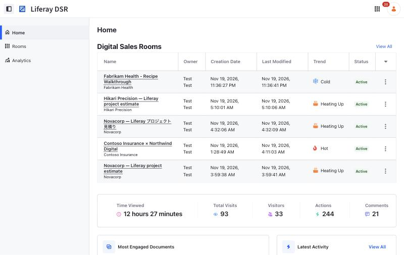{: .screenshot }

## Ingredients

| Ingredient | Type | Guide |
| --- | --- | --- |
| Liferay DXP 2026.Q3 or later, running (self-hosted bundle or Docker) | Platform | [Starting with a Docker Image](https://learn.liferay.com/w/dxp/getting-started/starting-with-a-docker-image) |
| Digital Sales Room app (`.lpkg`) and its activation key (`.xml`) | Marketplace app | [Activating Digital Sales Room](https://learn.liferay.com/w/digital-sales-room/activating-digital-sales-room) |
| Accounts | Built-in | [Accounts](https://learn.liferay.com/w/dxp/users-and-permissions/accounts) |
| Liferay Data Platform (Analytics Cloud) connection, for the analytics in step 7 | Analytics | [Engagement Metrics Dashboard](https://learn.liferay.com/w/digital-sales-room/engagement-metrics-dashboard) |

**Before you start, you need:**

- A running DXP 2026.Q3 or later, and an administrator who can sign in.
- The DSR `.lpkg` and its `.xml` activation key. DSR is a separate Marketplace purchase. Ask your Liferay account manager, or open the Products Catalog in One Liferay.
- A few PDFs to share. A proposal, a solution overview and a mutual action plan work well.

The screenshots on this page come from Liferay DXP 2026.Q4 in Docker. Other demo rooms appear in the lists, and the analytics show sample engagement data.

{: .important }
Use the DSR build that matches your DXP release. A 2026.Q3 `.lpkg` does not start on 2026.Q4. The log then shows *Only allowed bundles can add system object fields*.

## Steps

### Step 1: Activate Digital Sales Room

1. Copy the activation key (`.xml`) and the DSR `.lpkg` to `[Liferay Home]/deploy`. In Docker, that is `/opt/liferay/deploy`.
1. Watch the log until the DSR modules report `STARTED`, then restart Liferay.
1. Sign in as an administrator. Open the **Global Menu** → **Commerce** → **Digital Sales Room Management**.

The first request after startup creates the DSR site. If the launchpad is empty right after a restart, reload the page once.

See [Activating Digital Sales Room](https://learn.liferay.com/w/digital-sales-room/activating-digital-sales-room) for details and for license expiry.

### Step 2: Create the prospect account and its people

A room belongs to an **account**. The account sets who you can invite into the room.

1. Open **Global Menu** → **Applications** → **Accounts** and add a *Business* account, for example **Fabrikam Health**.
1. Under **Users**, add the buyer's people to the account, such as the project sponsor and the IT lead.
1. Make sure your sellers can sign in. Add a seller user for yourself, or use your own administrator for this recipe.

### Step 3: Create the room

1. In the DSR launchpad, open **Rooms** and click **New Digital Sales Room**.
1. **Account Association:** type the account name and pick **Fabrikam Health**. Click **Next**.

   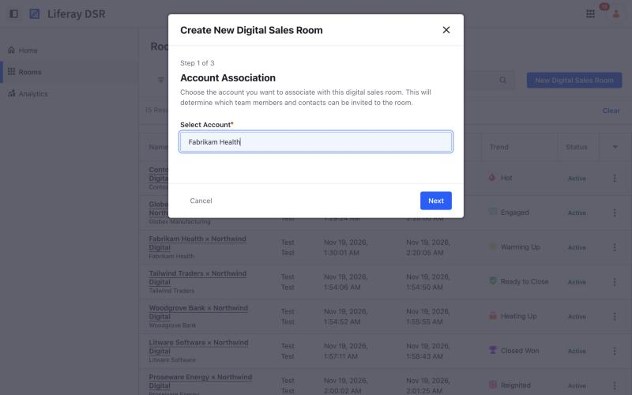{: .screenshot }

1. **Choose a Template:** pick **DSR**, the template that ships with the app. The preview shows the Onboarding and Documents pages the room starts with. Click **Next**.

   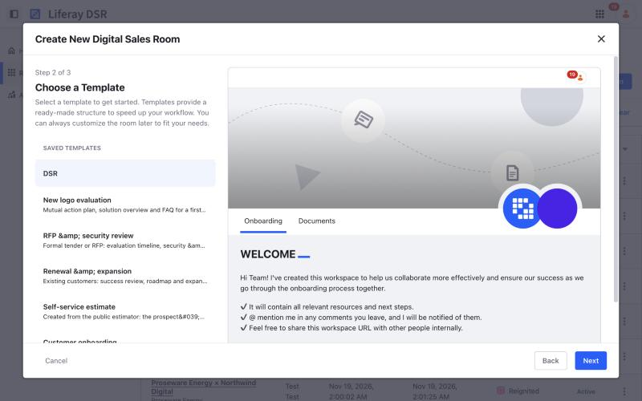{: .screenshot }

   The list shows every **Site Template** in your instance. To give rooms your own starting point, such as a mutual action plan page or an FAQ, build a site template under **Control Panel** → **Sites** → **Site Templates**. It then appears here.

1. **Name Your Room:** enter a name the buyer will recognize, and a short friendly URL. Click **Save**.

   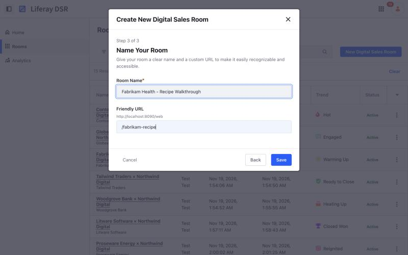{: .screenshot }

Liferay builds the room as its own site and opens the Onboarding page in the page editor.

### Step 4: Make the room yours

The room is an ordinary Liferay page, so you edit it with fragments in the page editor:

- Change the welcome text to speak to this buyer and their goals.
- Replace the seller card (name, title, photo) with the account executive's.
- Change the video, or add sections for the agenda and the next steps.

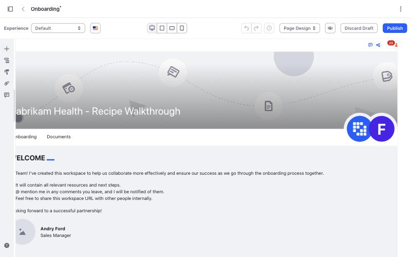{: .screenshot }

Click **Publish**. This is what the buyer sees:

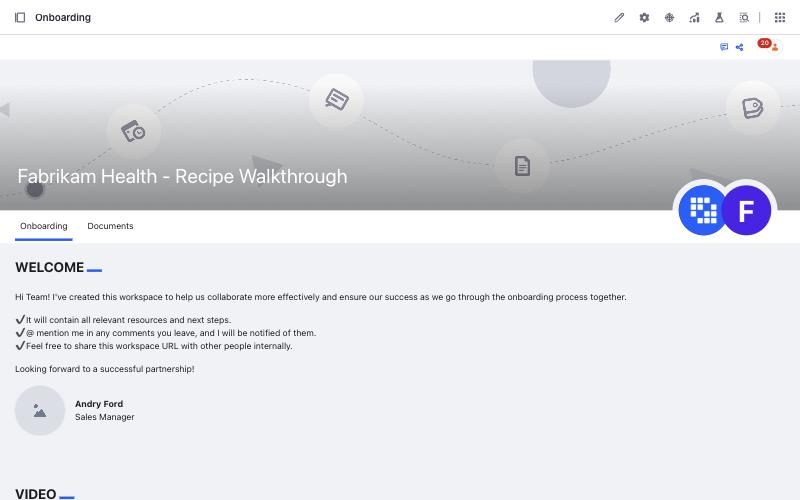{: .screenshot }

### Step 5: Add the documents

Open the **Documents** tab and click **New** to upload your PDFs. Everything you upload here stays inside this room, and the room's analytics count each preview and download.

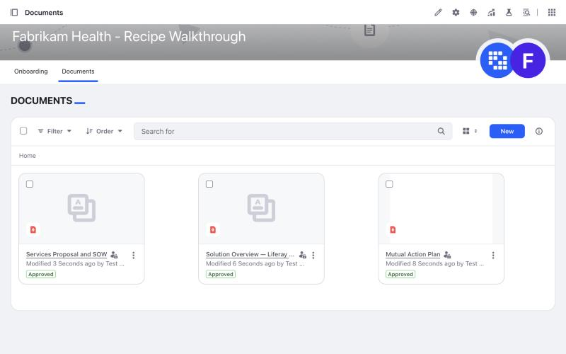{: .screenshot }

See [Managing Room Documents](https://learn.liferay.com/w/digital-sales-room/managing-room-documents).

### Step 6: Invite the buyers

Click **Share** (the share icon in the room header, or **Actions** → **Share** in the Rooms list).

1. Enter one or more email addresses.
1. Pick a role for them:

   | Role | Can do |
   | --- | --- |
   | **Room Collaborator** | Manage pages and documents, comment, share the room |
   | **Content Contributor** | View, comment, upload documents, share the room |
   | **Viewer** (default) | View documents and comment, but not upload |

1. Optionally set **Access Valid Until**. Access then ends at the end of that day (UTC). This suits a tender with a fixed deadline, or an outside advisor.
1. Click **Invite**. Invitations are valid for 48 hours.

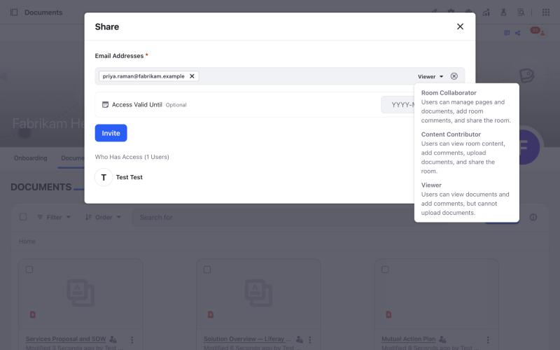{: .screenshot }

Give the buyer's sponsor **Room Collaborator** so they can bring in their own team. Most buyers only need **Viewer** or **Content Contributor**.

### Step 7: Talk in the room, and follow the deal

**Room comments.** Open the comments panel (the speech-bubble icon in the room header) to post a note, answer a question, or @mention someone. Both sides see the same thread, so the questions stay out of email.

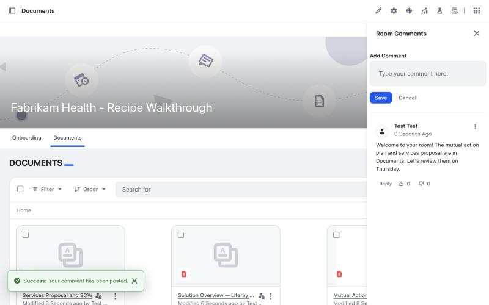{: .screenshot }

**Trend and status.** In the **Rooms** list, each room shows a **Trend**, from *Cold* through *Heating Up*, *Hot* and *Ready to Close* to *Closed Won* or *Reignited*. Update it as the deal moves. The **Actions** menu also lets you **Duplicate** a room (pages and chosen documents, without comments or members), open **Room Settings**, **Archive** a finished deal (reversible, and read-only for buyers) or **Delete** it.

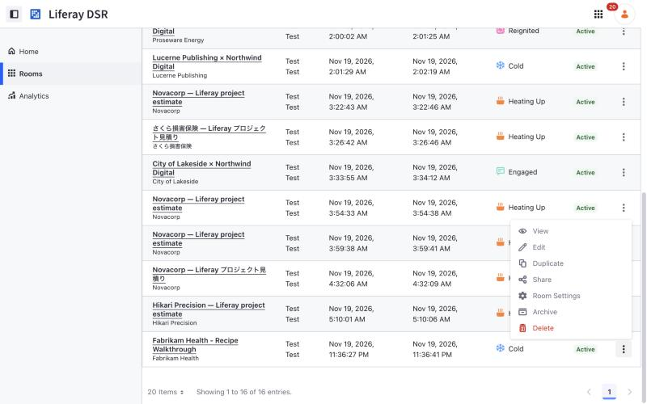{: .screenshot }

**Analytics.** With the instance connected to Liferay Data Platform, the **Analytics** page shows time viewed, visits, visitors, actions and comments for all rooms or one room. It also lists the most active visitors and the latest activity, such as who previewed or downloaded which document.

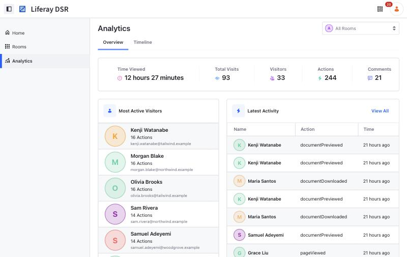{: .screenshot }

The **Timeline** tab charts engagement over time. You can filter it by date range and by user, so you can see when a buyer's team picks the deal up again.

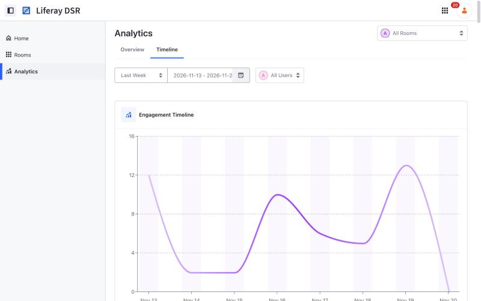{: .screenshot }

See [Engagement Metrics Dashboard](https://learn.liferay.com/w/digital-sales-room/engagement-metrics-dashboard). Without an Analytics Cloud token under **Instance Settings** → **Analytics Cloud**, the dashboard stays empty.

## Result

You took a vanilla DXP to a working Digital Sales Room for a real deal:

- DSR is activated, and the launchpad lists your rooms with their trend and status.
- The prospect has a room linked to its account, with a tailored Onboarding page and the deal documents.
- The buyers are invited with the right role, and access ends on the date you choose.
- Questions stay in room comments, and the analytics show who engages with what.

Repeat steps 3 to 6 for each new deal. Build your own site templates (step 3) for the deal types you sell most, such as new-logo evaluations, RFPs and renewals, so each room starts half-built.

**Learn more:** [Digital Sales Room documentation](https://learn.liferay.com/w/digital-sales-room/index) · [Managing Rooms](https://learn.liferay.com/w/digital-sales-room/managing-rooms) · [DSR Launchpad](https://learn.liferay.com/w/digital-sales-room/dsr-launchpad) · [Room Comments](https://learn.liferay.com/w/digital-sales-room/room-comments)
