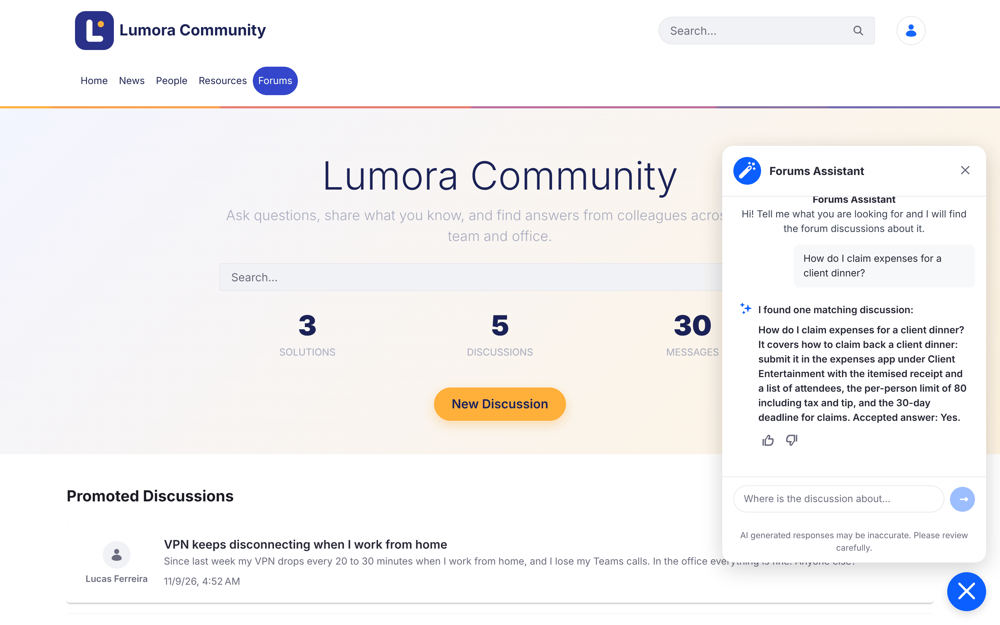
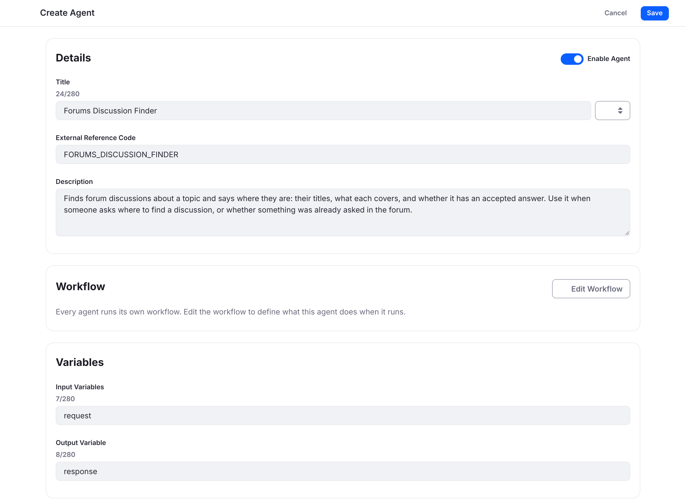
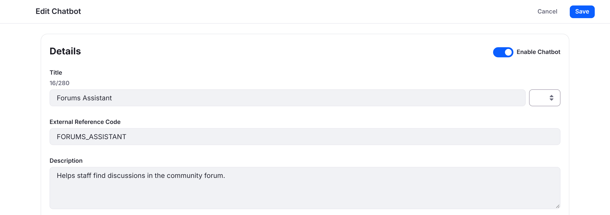
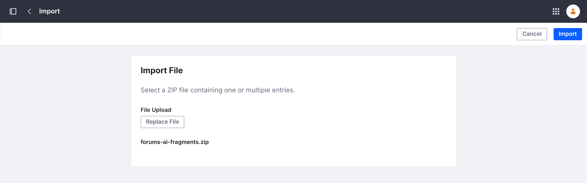
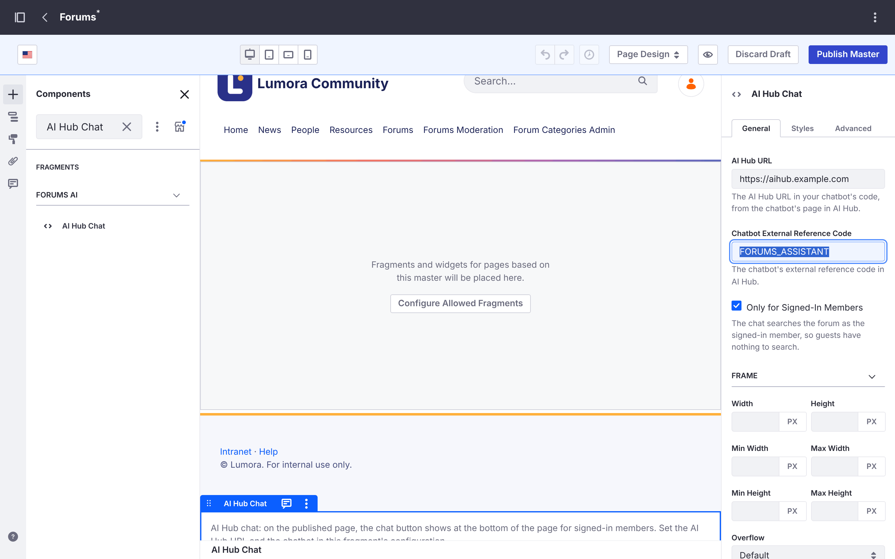
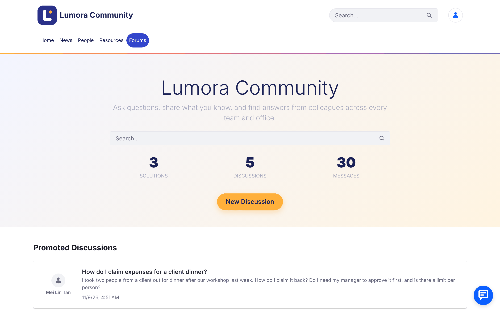

# Forums Assistant with AI Hub
{: .no_toc }

{: .important }
Liferay AI Hub is in beta: [request access](https://learn.liferay.com/w/ai-hub/index) before you start. On Liferay DXP 2026.Q1, you also need AI Hub support for your update, which you request from Liferay Support (Step 2).



1. TOC
{:toc}

## What You'll Build

A **Forums Assistant** chat on your [Liferay Forums](/liferay-forums/) site. Staff ask everyday questions, such as *"How do I claim expenses for a client dinner?"* or *"Has anyone had the VPN dropping when working from home?"*, and the assistant answers with the matching discussions: their titles, what each one covers, and whether it has an accepted answer. It searches the forum as the signed-in member, so it only finds discussions that member can already see.

{: .screenshot }

The screenshots show a forum branded as a fictitious company, *Lumora Community*, as the Liferay Forums guide describes in [Matching Your Company's Look](/liferay-forums/administering/customizing.html#matching-your-companys-look).

{: .note }
AI summaries at the top of each discussion come in a later version of this recipe.

## Ingredients

| Ingredient | Type | Guide |
| --- | --- | --- |
| Liferay Forums 1.0.0 | Marketplace App | [Liferay Forums guide](/liferay-forums/) |
| Liferay AI Hub: an agent and a chatbot | Liferay product (beta) | [AI Hub](https://learn.liferay.com/w/ai-hub/index), [Agent Workflows](https://learn.liferay.com/w/ai-hub/agent-workflows), [Chatbots](https://learn.liferay.com/w/ai-hub/chatbots) |
| Liferay DXP connected to AI Hub | DXP feature | [Integrating AI Hub with Liferay DXP](https://learn.liferay.com/w/ai-hub/integrating-ai-hub-with-liferay-dxp) |
| Fragments and master pages | DXP feature | [Managing Fragments](https://learn.liferay.com/w/dxp/site-building/creating-pages/page-fragments-and-widgets/using-fragments/managing-fragments), [Master Page Templates](https://learn.liferay.com/w/dxp/site-building/creating-pages/defining-headers-and-footers/master-page-templates) |

**Downloads:**

| File | What it is |
| --- | --- |
| [forums-ai-fragments.zip](downloads/forums-ai-fragments.zip) | The **Forums AI** fragment set, with the **AI Hub Chat** fragment that puts AI Hub's chat on the forum's pages |
| [forums-discussion-finder.workflow.xml](downloads/forums-discussion-finder.workflow.xml) | The workflow of the **Forums Discussion Finder** agent |

Both are available under the same licenses as Liferay Forums: [LGPL-2.1-or-later](downloads/LICENSES/LGPL-2.1-or-later.txt) or the [Liferay DXP EULA](downloads/LICENSES/LicenseRef-Liferay-DXP-EULA-2.0.0-2023-06.txt).

**Before you start, you need:**

- Liferay DXP 2026.Q1 LTS with Liferay Forums 1.0.0 installed and its forum site created. This recipe was tested on 2026.Q1.4 with hotfix 84 and PostgreSQL.
- An AI Hub account, with the **Client ID** and **Client Secret** Liferay provided for it.
- Administrator access to the forum's Liferay.
- The forum's Liferay reachable from the internet, so AI Hub can reach it. For testing on your own computer, see the note on tunnels in [Integrating AI Hub with Liferay DXP](https://learn.liferay.com/w/ai-hub/integrating-ai-hub-with-liferay-dxp).

## Steps

### Step 1: Install Liferay Forums

Install Liferay Forums and create the forum site as the [Liferay Forums guide](/liferay-forums/) describes.

Once the site exists, remove the site initializer zip as the guide says. If it stays deployed, it runs again at every Liferay start and resets the site's templates and master page, including the chat you add in Step 6.

### Step 2: Enable AI Hub on the Forum's Liferay

The chat runs on the forum's pages and searches the forum as the signed-in member, so the forum's Liferay must be connected to AI Hub. [Integrating AI Hub with Liferay DXP](https://learn.liferay.com/w/ai-hub/integrating-ai-hub-with-liferay-dxp) describes the connection.

1. **On Liferay DXP 2026.Q1, request AI Hub support from Liferay Support.** 2026.Q1.4 with hotfix 84, the update this recipe was tested on, doesn't include everything the connection needs. Open a Support ticket asking for **AI Hub support (LPD-93555 and LPD-107054)** for your 2026.Q1 update (for example, 2026.Q1.4), and give your current update and hotfix. Liferay Support provides it as a hotfix or as the update that includes it. Newer quarterly releases may include it already: check with Liferay Support.
1. **Turn on the feature flag:** *Control Panel* → *Instance Settings* → *Feature Flags* → *Release*, then enable **AI Hub (LPD-62272)**. On Liferay Self-Hosted, you can set it in `portal-ext.properties` instead:

   ```properties
   feature.flag.LPD-62272=true
   ```

{: .note }
This recipe was tested on 2026.Q1.4 with a pre-release build of the AI Hub connection, so some labels may differ slightly in your version.

### Step 3: Connect the Forum's Liferay to AI Hub

1. In the forum's Liferay, go to *Control Panel* → *Instance Settings*, and under *Platform* click **AI Hub**. Enter the **Client ID** and **Client Secret** Liferay provided, and the AI Hub **Service URL** given in [Integrating AI Hub with Liferay DXP](https://learn.liferay.com/w/ai-hub/integrating-ai-hub-with-liferay-dxp). Click **Save**.
1. In AI Hub, click **Configurations**. In **Environment URLs**, add the forum's address, such as `https://forums.example.com`, and click **Save**. AI Hub uses this address to search the forum and to let the chat load on the forum's pages.
1. If the forum's Liferay doesn't serve the host name in that address yet, add it to the valid host names in `portal-ext.properties`, keeping the ones you already use. Otherwise the chat's searches fail with *Invalid host name*.

   ```properties
   virtual.hosts.valid.hosts=localhost,127.0.0.1,forums.example.com
   ```

### Step 4: Create the Forums Discussion Finder Agent

The agent searches the forum's discussions with AI Hub's **Liferay Search** step, limited to the forum's topics and replies (the `C2M0Thread` and `C2M0Message` objects).

1. **Find the two objects' class names** on the forum's Liferay. They differ on every Liferay installation. With an administrator's email address and password:

   ```bash
   curl -u "admin@example.com:password" "https://forums.example.com/o/object-admin/v1.0/object-definitions/by-external-reference-code/C2M0_THREAD?fields=className"
   curl -u "admin@example.com:password" "https://forums.example.com/o/object-admin/v1.0/object-definitions/by-external-reference-code/C2M0_MESSAGE?fields=className"
   ```

    Each returns a class name such as `com.liferay.object.model.ObjectDefinition#J6B8`. You can also run the same request, **getObjectDefinitionByExternalReferenceCode**, from the forum's API Explorer (`/o/api`, *object-admin*).
1. **Download** [forums-discussion-finder.workflow.xml](downloads/forums-discussion-finder.workflow.xml). Replace `C2M0_THREAD_CLASS_NAME` and `C2M0_MESSAGE_CLASS_NAME` with the two class names.
1. **In AI Hub, add an agent:**
    - **Title:** `Forums Discussion Finder`
    - **External Reference Code:** `FORUMS_DISCUSSION_FINDER`, or the code AI Hub suggests. Codes are unique across the whole AI Hub, so use AI Hub's code if this one is taken.
    - **Description:** the chatbot picks an agent by its description, so use this one, or one that says the same:

      ```text
      Finds forum discussions about a topic and says where they are: their titles, what each covers, and whether it has an accepted answer. Use it when someone asks where to find a discussion, or whether something was already asked in the forum.
      ```

    - **Input Variables:** `request`
    - **Output Variable:** `response`

    {: .screenshot }
1. Click **Edit Workflow**, open the workflow's code view, replace its content with your edited workflow file, and click **Update**. Then **Save** the agent.

The workflow has one LLM step. It names each discussion by its exact title, so people can find it with the forum's search. Its instructions treat forum posts as data written by members, never as instructions, and only list discussions that appear in the search results.

### Step 5: Create the Forums Assistant Chatbot

In AI Hub, add a chatbot:

- **Title:** `Forums Assistant`
- **External Reference Code:** `FORUMS_ASSISTANT`, or the code AI Hub suggests
- **Description:** `Helps staff find discussions in the community forum.`
- **Assigned Agents:** Forums Discussion Finder
- **Placeholder Message:** `Where is the discussion about...`
- **Intro Message:** `Hi! Tell me what you are looking for and I will find the forum discussions about it.`
- **Suggested questions:** a few questions your staff ask, such as *How do I claim expenses for a client dinner?* or *Where are the latest logo files and slide templates?*
- **Allow guest access:** off. The chat searches as the signed-in member, so guests have nothing to search.

{: .screenshot }

Save it. Its page then shows the **Chatbot Code**. You need two values from it in Step 6: the AI Hub address (`ai-hub-url`) and the chatbot's external reference code (`chatbot-external-reference-code`).

### Step 6: Add the Chat to the Forum Site

1. **Import the fragment.** Download [forums-ai-fragments.zip](downloads/forums-ai-fragments.zip). In the forum site, go to *Design* → *Fragments*, open the actions menu (⋮) next to *Fragment Sets*, and choose **Import**. Select the zip and click **Import**. The **Forums AI** fragment set appears, with the **AI Hub Chat** fragment.

    {: .screenshot }

1. **Place it on every forum page.** Go to *Design* → *Page Templates* → *Masters* and open **Forums**. Search for **AI Hub Chat** and drag it below the footer. Select it, and in its settings enter:
    - **AI Hub URL:** the `ai-hub-url` from the chatbot's code
    - **Chatbot External Reference Code:** the chatbot's code, such as `FORUMS_ASSISTANT`
    - **Only for Signed-In Members:** leave it checked

    {: .screenshot }

1. Click **Publish Master**.

To update the fragment later, import the new zip with **Overwrite Existing Items** checked, then open the fragment's actions menu, choose **View Usages**, select all and click **Propagate**: placed fragments keep their old version until then. See [Propagating Fragment Changes](https://learn.liferay.com/w/dxp/site-building/creating-pages/page-fragments-and-widgets/using-fragments/propagating-fragment-changes).

## Result

Sign in to the forum as a member. The chat button shows at the bottom right of every forum page.

{: .screenshot }

Open it and ask about a discussion that you know exists, such as *How do I claim expenses for a client dinner?* The assistant names the matching discussion, says what it covers and whether it has an accepted answer, as in the screenshot at the top of this page. If a discussion has a suspicious post, such as one asking the AI to do something, it says so rather than repeating it.

Check that:

- **Guests don't see the chat button**, with **Only for Signed-In Members** checked.
- **The assistant finds only what the member can see:** a discussion a member can't open doesn't appear in their answers.

**Known limitations:**

- **Answers name discussions by title, without links:** AI Hub's search results don't include the discussions' page addresses yet. Members find a discussion with the forum's search.
- **If the chat doesn't load or answer,** check that the forum's address is in AI Hub's **Environment URLs** (Step 3) exactly as members open it, including `https://`.

**Where next:**

- [Matching Your Company's Look](/liferay-forums/administering/customizing.html#matching-your-companys-look) in the Liferay Forums guide, to brand the forum like the screenshots.
- AI summaries of each discussion, in a later version of this recipe.
