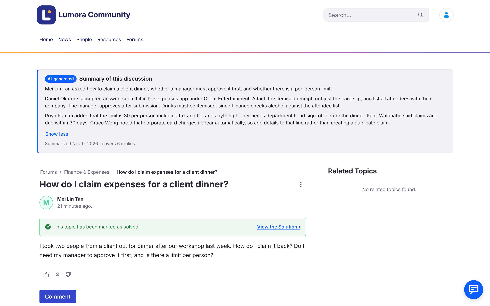
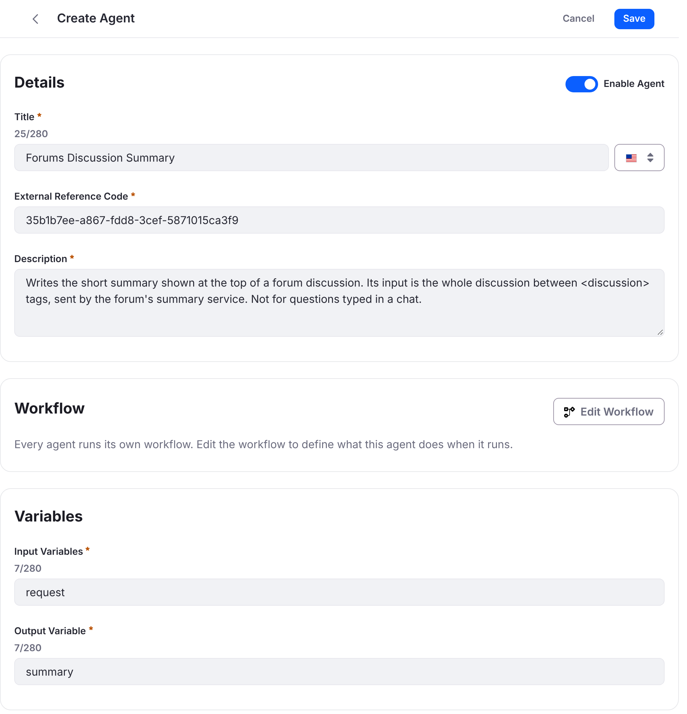
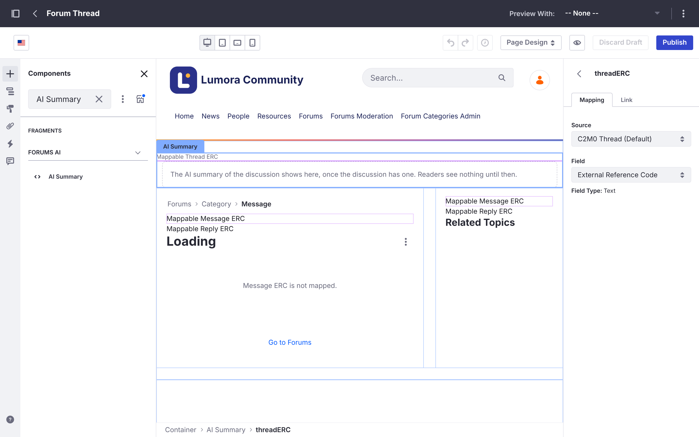
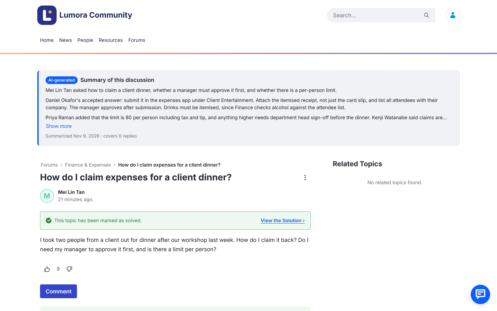

# AI Discussion Summaries with AI Hub
{: .no_toc }

{: .important }
Liferay AI Hub is [generally available from Liferay DXP 2026.Q3](https://learn.liferay.com/w/updates/release-notes/liferay-dxp/2026.q3/highlights/ai-hub-generally-available), with a 30-day free trial. On Liferay DXP 2026.Q1, where AI Hub is in beta, you also need AI Hub support for your update, which you request from Liferay Support (Step 2). This recipe was tested on Liferay Self-Hosted with Docker; other Liferay environments haven't been tried yet.



1. TOC
{:toc}

## What You'll Build

An **AI summary at the top of busy discussions** on your [Liferay Forums](/liferay-forums/) site. Someone who opens a long topic, such as *"How do I claim expenses for a client dinner?"*, reads in a few lines what was asked, the accepted answer and who gave it, and what is still open, before scrolling through the replies.

{: .screenshot }

- **One summary per discussion, shared by every reader.** It's written on the server once a discussion has enough replies and has gone quiet, and again after new replies settle, not on every page view.
- **Marked as AI-generated,** with when it was written and how many replies it covers. Discussions without a summary look as they do today.
- **Written by an AI Hub agent** in your AI Hub account, so you manage its model, instructions and guardrails in AI Hub. Liferay runs it in a workflow, through its own connection to AI Hub, so the AI Hub credentials stay in Liferay.
- **Follows the forum's moderation:** a flagged topic shows no summary, and a summary is written again when posts are edited or deleted, so it never keeps what a moderator removed.

The forum's own packages aren't changed: the summaries are an add-on installed beside them. The screenshots show a forum branded as a fictitious company, *Lumora Community*, as the Liferay Forums guide describes in [Matching Your Company's Look](/liferay-forums/administering/customizing.html#matching-your-companys-look).

{: .note }
For a chat that finds discussions for members, see the [Forums Assistant with AI Hub](../forums-ai-assistant/) recipe. The two recipes work on their own or together, and share the same fragment set.

## Ingredients

| Ingredient | Type | Guide |
| --- | --- | --- |
| <span class="with-logo">Liferay Forums 1.0.0</span> | Marketplace App | [Liferay Forums guide](/liferay-forums/) |
| Liferay AI Hub: an agent | Liferay product (generally available from DXP 2026.Q3; beta on 2026.Q1) | [AI Hub](https://learn.liferay.com/w/ai-hub/index), [Agent Workflows](https://learn.liferay.com/w/ai-hub/agent-workflows) |
| Liferay DXP connected to AI Hub | DXP feature | [Integrating AI Hub with Liferay DXP](https://learn.liferay.com/w/ai-hub/integrating-ai-hub-with-liferay-dxp) |
| A workflow with an AI Hub agent step | DXP feature | [Workflow](https://learn.liferay.com/w/dxp/low-code/workflow) |
| The summary object and service | Client extensions | [Client Extensions](https://learn.liferay.com/w/dxp/development/client-extensions) |
| Fragments and display page templates | DXP feature | [Managing Fragments](https://learn.liferay.com/w/dxp/site-building/creating-pages/page-fragments-and-widgets/using-fragments/managing-fragments), [Display Page Templates](https://learn.liferay.com/w/dxp/sites/displaying-content/using-display-page-templates) |

**Downloads:** version 0.2.0 of the add-on.

| File | What it is |
| --- | --- |
| [liferay-forums-ai-summary-batch.zip](downloads/liferay-forums-ai-summary-batch.zip) | The **Forums AI Summary** object, which holds each discussion's summary |
| [liferay-forums-ai-summary-etc-spring-boot.zip](downloads/liferay-forums-ai-summary-etc-spring-boot.zip) | The **summary service**, which finds discussions that need a summary, starts the workflow for each, and saves the summary the workflow writes (32 MB) |
| [forums-ai-summary.workflow.xml](downloads/forums-ai-summary.workflow.xml) | The **Forums AI Summary** workflow: it runs the agent through the forum's AI Hub connection, then hands the summary to the service |
| [forums-discussion-summary.workflow.xml](downloads/forums-discussion-summary.workflow.xml) | The workflow of the **Forums Discussion Summary** agent |
| [forums-ai-fragments.zip](downloads/forums-ai-fragments.zip) | The **Forums AI** fragment set: **AI Summary** shows the summary on the topic page, and **AI Hub Chat** is for the [Forums Assistant](../forums-ai-assistant/) |
| [liferay-forums-ai-summary-0.2.0-source.zip](downloads/liferay-forums-ai-summary-0.2.0-source.zip) | The **source** of all of the above, to read or change them. Its README says how to build the zips |

All are available under the same licenses as Liferay Forums: [LGPL-2.1-or-later](downloads/LICENSES/LGPL-2.1-or-later.txt) or the [Liferay DXP EULA](downloads/LICENSES/LicenseRef-Liferay-DXP-EULA-2.0.0-2023-06.txt).

**Before you start, you need:**

- Liferay DXP 2026.Q1 LTS on Liferay Self-Hosted with Docker, with AI Hub support (Step 2), with Liferay Forums 1.0.0 installed, with its [required Liferay fixes](/liferay-forums/installing/#required-liferay-fixes), and its forum site created. This recipe was tested on 2026.Q1.4 with PostgreSQL.
- An AI Hub account, with the **Client ID** and **Client Secret** Liferay provided for it.
- Administrator access to the forum's Liferay, and access to the server that runs its Docker containers.

## Steps

### Step 1: Install Liferay Forums

Install Liferay Forums and create the forum site as the [Liferay Forums guide](/liferay-forums/) describes.

Once the site exists, remove the site initializer zip as the guide says. If it stays deployed, it runs again at every Liferay start and resets the site's templates, including the summary you add in Step 7.

### Step 2: Connect the Forum's Liferay to AI Hub

Liferay runs the summary agent through its own connection to AI Hub, so the AI Hub credentials stay in Liferay. [Integrating AI Hub with Liferay DXP](https://learn.liferay.com/w/ai-hub/integrating-ai-hub-with-liferay-dxp) describes the connection.

1. **On Liferay DXP 2026.Q1, request AI Hub support from Liferay Support.** 2026.Q1 updates, including 2026.Q1.4 that this recipe was tested on, don't include everything the summaries need. Open a Support ticket asking for **AI Hub support (LPD-107054 and LPD-107058)** for your 2026.Q1 update (for example, 2026.Q1.4), and give your current update and hotfix:

    | LPD | What it adds |
    | --- | --- |
    | LPD-107054 | The connection to AI Hub: the *AI Hub* settings in *Instance Settings* |
    | LPD-107058 | The **AI Hub agent** step for workflows, which runs an AI Hub agent through that connection |

    If you also add the [Forums Assistant](../forums-ai-assistant/), ask for LPD-93555 in the same ticket. Liferay Support provides it as a hotfix or as the update that includes it. AI Hub is in beta on 2026.Q1 and backports are in progress, so a later 2026.Q1 update may include them: check with Liferay Support. On 2026.Q3 and later, skip this step.
1. **On 2026.Q1, turn on the feature flag:** *Control Panel* → *Instance Settings* → *Feature Flags* → *Release*, then enable **AI Hub (LPD-62272)**. On Liferay Self-Hosted, you can set it in `portal-ext.properties` instead:

    ```properties
    feature.flag.LPD-62272=true
    ```

1. **Connect it:** go to *Control Panel* → *Instance Settings*, and under *Platform* click **AI Hub**. Enter the **Client ID** and **Client Secret** Liferay provided, and the AI Hub **Service URL** given in [Integrating AI Hub with Liferay DXP](https://learn.liferay.com/w/ai-hub/integrating-ai-hub-with-liferay-dxp). Click **Save**.

{: .note }
This recipe was tested on 2026.Q1.4 with pre-release builds of these AI Hub backports, so some labels may differ slightly in your version.

### Step 3: Create the Forums Discussion Summary Agent

The agent turns one discussion into a short summary. It has a single LLM step and doesn't search anything: the workflow sends it the discussion.

1. **Download** [forums-discussion-summary.workflow.xml](downloads/forums-discussion-summary.workflow.xml).
1. **In AI Hub, add an agent:**
    - **Title:** `Forums Discussion Summary`
    - **External Reference Code:** `FORUMS_DISCUSSION_SUMMARY`, or the code AI Hub suggests. Codes are unique across the whole AI Hub, so use AI Hub's code if this one is taken, and put it in the workflow in Step 6.
    - **Description:**

      ```text
      Writes the short summary shown at the top of a forum discussion. Its input is the whole discussion between <discussion> tags, sent by the forum's summary service. Not for questions typed in a chat.
      ```

    - **Input Variables:** `request`
    - **Output Variable:** `summary`

    {: .screenshot }
1. Click **Edit Workflow**, open the workflow's code view, replace its content with the downloaded workflow file, and click **Update**. Then **Save** the agent.

The agent's instructions ask for plain text of at most 120 words, in the discussion's language: what was asked, the answer or what was agreed (the accepted answer first, and who gave it), and what is still open. They treat posts as data written by members, never as instructions, and don't assume anyone's gender. To change the summary's style or length, edit the instructions in the agent's LLM step.

### Step 4: Deploy the Summary Object

Copy [liferay-forums-ai-summary-batch.zip](downloads/liferay-forums-ai-summary-batch.zip) into Liferay's `osgi/client-extensions` folder, for example:

```bash
docker cp liferay-forums-ai-summary-batch.zip liferay:/opt/liferay/osgi/client-extensions/
```

Here `liferay` is the name of the forum's Liferay container. Liferay creates the **Forums AI Summary** object, site-scoped, and its **Forums AI Summary Status** picklist. Check that they appear in *Control Panel* → *Objects*.

### Step 5: Deploy and Run the Summary Service

The service runs as its own container next to Liferay. Every few minutes, it looks for discussions with enough replies that have gone quiet and starts the workflow of Step 6 for each one. When the workflow has the summary, it hands it back to the service, which saves it in the object. The service has no AI Hub settings.

1. **Deploy its client extension.** Copy [liferay-forums-ai-summary-etc-spring-boot.zip](downloads/liferay-forums-ai-summary-etc-spring-boot.zip) into `osgi/client-extensions` as in Step 4. Liferay creates the service's OAuth applications and its workflow action, **Forums AI Summary Save**, and writes its connection details, its *routes*, to `/opt/liferay/routes/default/liferay-forums-ai-summary-etc-spring-boot`.

    The service reads those routes, so Liferay's `/opt/liferay/routes` folder must be in a Docker volume or a folder on the server. In these examples, it's the volume `liferay-routes`, mounted when the Liferay container was created with `-v liferay-routes:/opt/liferay/routes`.
1. **Build the service's image** from the same zip:

    ```bash
    unzip liferay-forums-ai-summary-etc-spring-boot.zip -d forums-ai-summary-service
    docker build -t forums-ai-summary-service forums-ai-summary-service
    ```

1. **Run the service** in the Liferay container's network, so it reaches Liferay, and Liferay reaches it, at `localhost`:

    ```bash
    docker run -d --name forums-ai-summary --network container:liferay --restart unless-stopped \
      -v liferay-routes:/opt/liferay/routes:ro \
      -e LIFERAY_ROUTES_CLIENT_EXTENSION=/opt/liferay/routes/default/liferay-forums-ai-summary-etc-spring-boot \
      -e LIFERAY_ROUTES_DXP=/opt/liferay/routes/default/dxp \
      forums-ai-summary-service
    ```

    If your forum site's friendly URL isn't `/forums`, add `-e FORUMS_AI_SUMMARY_SITES=` with its path.
1. **Check that it's ready:**

    ```bash
    docker exec liferay curl -s http://localhost:58082/ready
    ```

    It answers `READY`. If it doesn't, `docker logs forums-ai-summary` says why.

**Settings.** Add any of these to `docker run` with `-e`:

| Setting | Default | What it sets |
| --- | --- | --- |
| `FORUMS_AI_SUMMARY_WORKFLOW` | `Forums AI Summary` | The workflow's name, from Step 6 |
| `FORUMS_AI_SUMMARY_SITES` | `forums` | The forum sites, by friendly URL path, comma-separated |
| `FORUMS_AI_SUMMARY_MIN_REPLIES` | `5` | Replies a discussion needs before it gets a summary |
| `FORUMS_AI_SUMMARY_QUIET_PERIOD_MINUTES` | `10` | Minutes without new replies or edits before a summary is written |
| `FORUMS_AI_SUMMARY_DAILY_LIMIT` | `200` | Summaries written a day (UTC), to keep AI Hub use predictable |
| `FORUMS_AI_SUMMARY_INTERVAL_SECONDS` | `300` | Time between the service's passes |
| `FORUMS_AI_SUMMARY_RETRY_MINUTES` | `60` | Time before a summary whose workflow didn't start, or hasn't saved it, is tried again. The stuck workflow is deleted first |
| `FORUMS_AI_SUMMARY_EDIT_LOOKBACK_HOURS` | `24` | How far back the service looks for edited posts; keep it longer than the service is ever stopped |
| `FORUMS_AI_SUMMARY_MAX_INPUT_CHARS` | `24000` | The longest discussion sent to the agent; longer ones are shortened |
| `FORUMS_AI_SUMMARY_MAX_SUMMARY_CHARS` | `1200` | The longest summary saved |

### Step 6: Deploy the Workflow

The **Forums AI Summary** workflow writes each summary in two steps: its **AI Hub agent** step runs the Forums Discussion Summary agent through the connection of Step 2, then its last step hands the summary to the service's workflow action.

1. **Download** [forums-ai-summary.workflow.xml](downloads/forums-ai-summary.workflow.xml). If AI Hub gave the agent another external reference code in Step 3, replace `FORUMS_DISCUSSION_SUMMARY` in the file with it.
1. **Deploy it** through Liferay's workflow API, with an administrator's email address and password, for example with `jq` and `curl`:

    ```bash
    jq -Rs '{name: "Forums AI Summary", title: "Forums AI Summary", content: .}' forums-ai-summary.workflow.xml |
      curl -u "admin@example.com:password" -H "Content-Type: application/json" -d @- \
        "https://forums.example.com/o/headless-admin-workflow/v1.0/workflow-definitions/deploy"
    ```

    The answer lists the workflow's steps, with `AI_HUB_AGENT` among them. You can also run the same request, **postWorkflowDefinitionDeploy**, from the forum's API Explorer (`/o/api`, *headless-admin-workflow*). The workflow then appears in *Control Panel* → *Workflow* → *Process Builder*.

You don't assign the workflow to anything: the service starts it, once for each summary, and it usually finishes in a few seconds.

### Step 7: Show the Summary on the Topic Page

1. **Import the fragments.** Download [forums-ai-fragments.zip](downloads/forums-ai-fragments.zip). In the forum site, go to *Design* → *Fragments*, open the actions menu (⋮) next to *Fragment Sets*, and choose **Import**. Select the zip and click **Import**. The **Forums AI** fragment set appears, with the **AI Summary** and **AI Hub Chat** fragments. If you've already imported it for the [Forums Assistant](../forums-ai-assistant/), you have it already.
1. **Place it on the topic page.** Go to *Design* → *Page Templates* → *Display Page Templates* and open **Forum Thread**. Search for **AI Summary** and drag it above the topic.
1. **Map it to the discussion.** Select the fragment's **Mappable Thread ERC** field, and in *Mapping*, keep the source **C2M0 Thread (Default)** and choose the field **External Reference Code**. The fragment reads the discussion's summary with it.

    {: .screenshot }

1. Click **Publish**.

In the template editor, the fragment shows a note in place of the summary. Readers see nothing until a discussion has one. In the fragment's settings, you can change its title, its *AI-generated* label, its details line, and how many lines it shows before **Show more**.

To update the fragments later, import the new zip with **Overwrite Existing Items** checked, then open the fragment's actions menu, choose **View Usages**, select all and click **Propagate**: placed fragments keep their old version until then. See [Propagating Fragment Changes](https://learn.liferay.com/w/dxp/site-building/creating-pages/page-fragments-and-widgets/using-fragments/propagating-fragment-changes).

## Result

Open a discussion with at least five replies, the default, where nobody has replied or edited a post for ten minutes. After the service's next pass, within five minutes, its summary shows at the top of the topic, collapsed to a few lines with **Show more**.

{: .screenshot }

Check that:

- **Short discussions have no summary:** a topic with fewer replies than `FORUMS_AI_SUMMARY_MIN_REPLIES` looks as it did before.
- **New replies update it:** reply to a summarized discussion. After the quiet period, the summary is written again and covers the new reply.
- **Moderation removes it:** when a moderator validates a report on a topic, its summary is hidden at the next pass. Edit or delete a post, and the summary is written again without it; with too few replies left, it's removed.
- **Members' posts can't instruct the AI:** a post that asks the AI to do something is treated as part of the discussion. The summary may say a post had off-topic content, without repeating it, and the summary is always shown as plain text.

**Known limitations:**

- **Tested only on Liferay Self-Hosted with Docker.** On other Liferay environments, the client extension and service may need other settings.
- **Summaries cover the whole topic for everyone who can open it:** the service summarizes what's posted in the topic, and the summary is shown to every reader of the topic page.
- **A summary isn't immediate:** it waits for the quiet period and the next pass. Lower the two settings to see it sooner, at the cost of more AI Hub runs.
- **If summaries don't appear,** check `docker logs forums-ai-summary`: the service logs each workflow it starts and each summary it saves, hides or removes. If it started a workflow but saved nothing, the agent didn't answer: Liferay's log says *Unable to complete AI hub agent node "summarize"* with the reason. Check the AI Hub connection (Step 2) and the agent's code in the workflow (Step 6). The service deletes a stuck workflow and tries again after `FORUMS_AI_SUMMARY_RETRY_MINUTES`.

**To remove the summaries:** take the AI Summary fragment off the **Forum Thread** template and publish it, stop and remove the `forums-ai-summary` container, remove both zips from `osgi/client-extensions`, and unpublish and delete the **Forums AI Summary** workflow in *Workflow* → *Process Builder*. The forum works as before. To delete the summaries too, delete the **Forums AI Summary** object and its **Forums AI Summary Status** picklist.

**Where next:**

- [Forums Assistant with AI Hub](../forums-ai-assistant/), for a chat that finds discussions for members.
- [Matching Your Company's Look](/liferay-forums/administering/customizing.html#matching-your-companys-look) in the Liferay Forums guide, to brand the forum like the screenshots.
