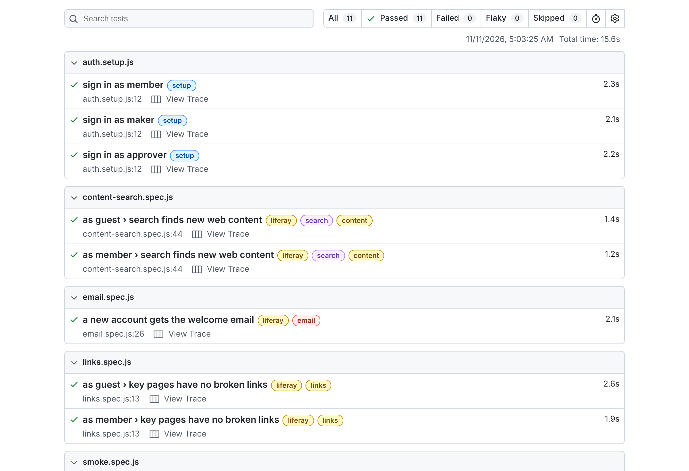
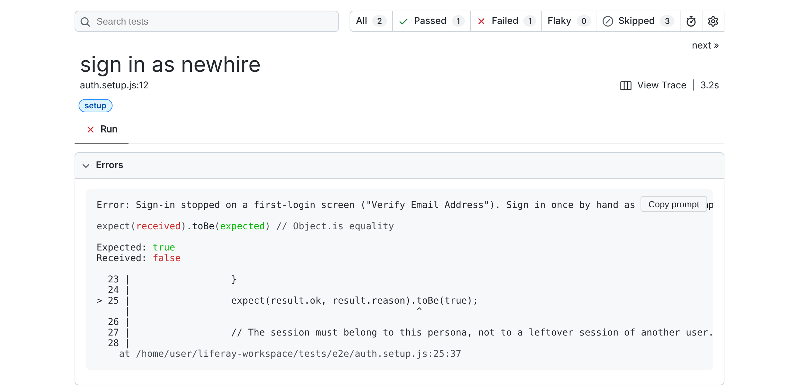
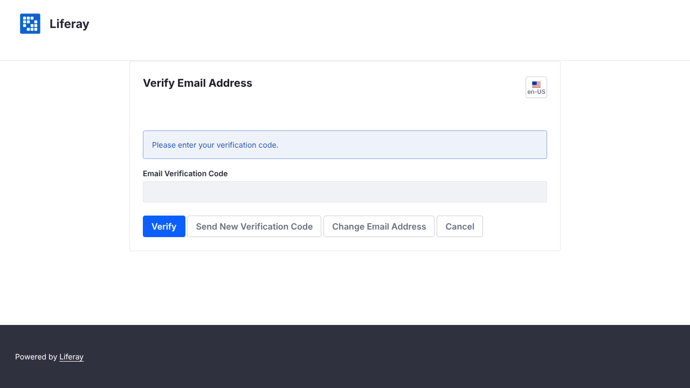
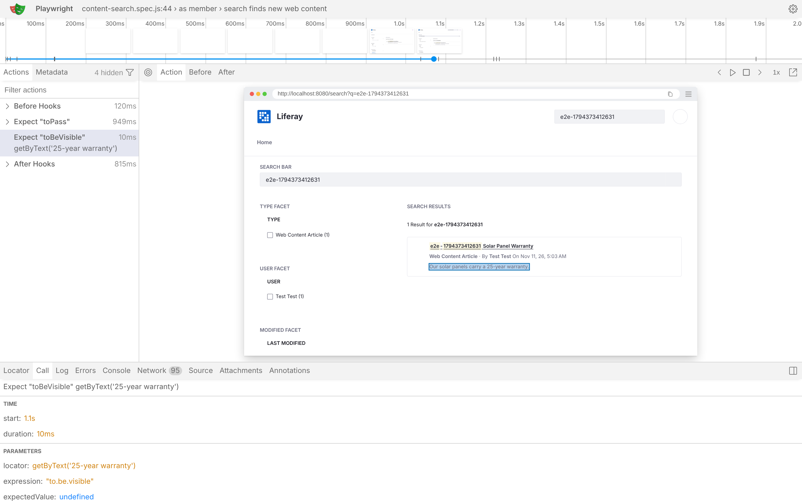
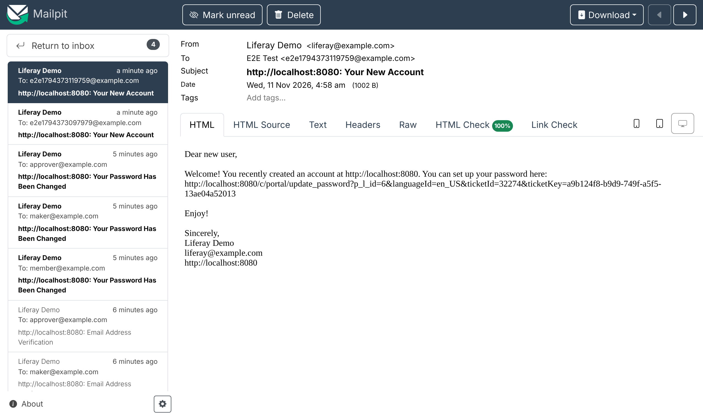

# AI-Assisted Test Automation with Playwright
{: .no_toc }

1. TOC
{:toc}

## What You'll Build

A **Playwright end-to-end test suite** in your existing Liferay Workspace. It signs in as real test users, such as a site member or a partner, and as Guest, and checks what each of them sees in a real browser. Your **AI coding agent** writes the tests from your acceptance criteria, runs them, and tells you why a test failed. You review each test before you commit it.

```text
your-workspace/
├── .claude/skills/e2e-tests/SKILL.md   ← how your agent writes, runs and triages the tests
├── .agents/skills/e2e-tests/SKILL.md   ← the same skill, for other agents
├── client-extensions/ …                ← your existing workspace, unchanged
└── tests/e2e/
    ├── playwright.config.js
    ├── auth.setup.js                   ← signs each test user in once per run
    ├── lib/liferay.js                  ← Liferay sign-in and helpers
    ├── smoke.spec.js                   ← first tests: Guest and a signed-in member
    └── test-users.properties           ← your test users (git-ignored)
```

## Ingredients

| Ingredient | Type | Guide |
| --- | --- | --- |
| Your Liferay Workspace, with a running Liferay DXP | Liferay Workspace | [Liferay Workspace](https://learn.liferay.com/w/dxp/development/tooling/liferay-workspace) |
| Playwright Test | Open-source test runner | [playwright.dev](https://playwright.dev/docs/intro) |
| An AI coding agent: Claude Code, or another agent that reads Agent Skills | AI coding agent | [Claude Code](https://code.claude.com/docs) |
| Playwright MCP server (optional) | Lets the agent open and inspect pages itself | [Playwright MCP](https://github.com/microsoft/playwright-mcp) |

**Download:**

| File | What it is |
| --- | --- |
| [liferay-playwright-e2e.zip](downloads/liferay-playwright-e2e.zip) | The `tests/e2e` suite and the `e2e-tests` agent skill, laid out to unzip at your workspace root |

**Before you start, you need:**

- A Liferay Workspace (any DXP version with the standard Login portlet) and its Liferay running, locally or on a test environment you can reach.
- Node.js 20 or later.
- Google Chrome installed. The suite uses your installed Chrome, so Playwright doesn't need to download a browser.
- One or more **test users** that can sign in. Use ordinary accounts, never the administrator.

The suite, the examples and the screenshots on this page were run against Liferay Portal 7.4 GA132 (Community Edition) in Docker, with Mailpit as the mail catcher.

{: .important }
Never test as the administrator. An admin session or a Basic Auth request can read things a real user can't, so the test passes even when the user's view is broken. The suite signs in as each test user through the normal sign-in page.

## Steps

### Step 1: Add the Suite to Your Workspace

1. Unzip [liferay-playwright-e2e.zip](downloads/liferay-playwright-e2e.zip) at your workspace root, the folder that holds `gradle.properties` and `settings.gradle`. It adds `tests/e2e/`, `.claude/skills/e2e-tests/` and `.agents/skills/e2e-tests/`, and changes nothing else. If your workspace already has a `tests/e2e` folder, unzip somewhere else first and merge by hand.
1. Install Playwright Test:

   ```bash
   cd tests/e2e
   npm install
   ```

`tests/e2e/.gitignore` keeps the test users file, the saved sessions, `node_modules` and the reports out of Git, so you don't need to change your workspace's own `.gitignore`.

| File | What it does |
| --- | --- |
| `lib/liferay.js` | Signs a test user in through `/c/portal/login`, which shows the Login portlet on any site. Then it checks whose session it is by calling `/o/headless-admin-user/v1.0/my-user-account`. It also has `sessionFetch`, for calling a headless API from the page as that user, and `adminAPI`, for test setup and cleanup (see [Common Liferay Regression Scenarios](#common-liferay-regression-scenarios)). |
| `env.js` | Works out the base URL, the test users file, and which test users to sign in |
| `auth.setup.js` | Runs first: signs each test user in once and saves the session to `.auth/<alias>.json`. It signs in through a browser that Playwright doesn't trace, so passwords never appear in a trace or the report, even with `--trace on`. |
| `playwright.config.js` | Uses your installed Chrome, keeps a trace and a screenshot of each failure, and writes an HTML report |
| `smoke.spec.js` | Three first tests: as Guest, the home page loads signed out and the Control Panel answers `404`; the `member` test user is signed in |

### Step 2: Add Your Test Users

1. In Liferay, create a test user, or use an existing non-admin account, with the roles and site membership that the user you're testing would have.
1. **Sign in once as that user by hand**, in a private browser window, and complete any first-login screens. A user created by an administrator or through the API usually has to **verify their email address** and **change their password** the first time. On Liferay Portal 7.4 GA132, the password change was required even with `passwords.default.policy.change.required=false`. Other instances can also ask for the terms of use or a security question. The suite stops at these screens and names the one it hit (Step 7 shows an example); it doesn't complete them for you.
1. Copy `tests/e2e/test-users.properties.example` to `tests/e2e/test-users.properties` and add each test user under a short alias:

   ```properties
   member.email=jane.member@example.com
   member.password=<password>
   ```

The setup signs in the `member` alias by default. To sign in others, list them when you run the tests (Step 3), for example `E2E_PERSONAS=member,partner`.

### Step 3: Run It

From `tests/e2e`:

```bash
npx playwright test
```

```text
  ✓  1 [setup] › auth.setup.js › sign in as member
  ✓  2 [liferay] › smoke.spec.js › Guest › the home page loads, signed out
  ✓  3 [liferay] › smoke.spec.js › Guest › the Control Panel answers 404 to Guest
  ✓  4 [liferay] › smoke.spec.js › member › is signed in as the member

  4 passed
```

To see the report, with a trace and a screenshot of any failure:

```bash
npx playwright show-report
```

{: .screenshot }

The report above is from a run of the suite with the example tests from [Common Liferay Regression Scenarios](#common-liferay-regression-scenarios).

The suite finds the address of your Liferay on its own:

| Setting | Used when |
| --- | --- |
| `LIFERAY_BASE_URL=https://test.example.com` | Always, when set: use it to test another environment |
| `web.server.host` in `bundles/portal-ext.properties` or `configs/local/portal-ext.properties` | When it's set, for example behind a tunnel or a proxy. Pages then carry links to that host, so the browser must use it too. |
| `http://localhost:8080` | Otherwise |

If you can't install Chrome, for example on a CI runner, run `npx playwright install chromium` and set `E2E_CHANNEL=chromium`.

### Step 4: Give Your Agent the Skill

The zip includes an `e2e-tests` skill: instructions your agent loads when you ask it for a test. It tells the agent:

- **Where things are:** the specs, the sign-in helper, the test users file.
- **How to write a test:** start from the acceptance criteria, read the real selectors from your fragments and client extensions, and prove a restriction from both sides.
- **How to triage a failure:** decide whether the product, the environment or the test is wrong.
- **What it must never do:** sign in as the administrator, print a password, or weaken a test to make it pass.

Claude Code finds the skill in `.claude/skills/` on its own. Other agents that read the Agent Skills layout find the copy in `.agents/skills/`. If your workspace has a `CLAUDE.md` or `AGENTS.md` that lists its skills, add a line:

```markdown
| Write, run, or triage an automated end-to-end test in `tests/e2e` | `e2e-tests` |
```

### Step 5: Let the Agent See the Page (Optional)

To pick selectors that work, the agent needs to see the real page, not guess from the code. The [Playwright MCP server](https://github.com/microsoft/playwright-mcp) lets it open a page, click through it, and read the page's accessibility tree, which is what `getByRole` matches. To add it to Claude Code:

```bash
claude mcp add playwright npx @playwright/mcp@latest
```

{: .note }
The MCP browser starts signed out, so it sees what Guest sees. Use it to explore the page's structure. Prove what a signed-in user sees with the suite itself, never by signing in as the administrator in the MCP browser.

### Step 6: Have the Agent Write a Test From Your Acceptance Criteria

Give the agent the same acceptance criteria you'd give a person. For example, for a members-only page:

💬 **Prompt:**

```
Using e2e-tests, write tests/e2e/member-resources.spec.js for ticket
PROJ-123, tagged @PROJ-123:

- A signed-in member opens /web/intranet/member-resources and sees the
  "Member Resources" heading and at least one resource card.
- Guest gets a 404 on that page, and the home page shows no link to it.

Find the page and the card's markup in our site initializer and fragments.
Test as the member alias and as Guest. Run the suite and show me the
result. If a test fails, tell me whether it's the product, the environment
or the test, and don't change any permissions to make it pass.
```

Expect a spec like this one. The paths and names come from your own site:

```javascript
import {expect, test} from '@playwright/test';

import {authFile} from './env.js';

const PAGE = '/web/intranet/member-resources';

test.describe('member', () => {
	test.use({storageState: authFile('member')});

	test('sees the member resources', {tag: '@PROJ-123'}, async ({page}) => {
		const response = await page.goto(PAGE);

		expect(response.status()).toBe(200);
		await expect(page.getByRole('heading', {name: 'Member Resources'})).toBeVisible();
		await expect(page.locator('.resource-card').first()).toBeVisible();
	});
});

test.describe('Guest', () => {
	test('gets a 404 and no link to the page', {tag: '@PROJ-123'}, async ({page}) => {
		const response = await page.goto(PAGE);

		expect(response.status()).toBe(404);

		await page.goto('/');

		await expect(page.locator(`a[href$="${PAGE}"]`)).toHaveCount(0);
	});
});
```

**Review it before you commit it.** Check that:

- Every user is expected to see **something**, so an empty or broken page can't pass.
- Each restriction is tested from both sides: one user sees it, another doesn't.
- No test signs in as the administrator or uses Basic Auth.

Then **watch it fail once**. Remove the member role's View permission on the page, run the suite, and check that the member test fails. Then restore the permission. A test you've never seen fail doesn't prove anything.

### Step 7: Triage Failures With the Agent

When a run fails, give the agent the failure rather than reading the trace yourself:

```
Using e2e-tests, run the suite. For each failure, open its trace and tell me
whether it's the product, the environment or the test, with the evidence.
Don't change any test until I agree.
```

The skill lists the usual Liferay causes:

| Symptom | Usual cause |
| --- | --- |
| Setup stops on a first-login screen, such as "Verify Email Address" or "Change Password" | The test user hasn't completed their first sign-in: sign in once by hand as that user |
| "The Login portlet says: Authentication failed" | Wrong password, an inactive user, or an instance that signs in by screen name rather than email |
| A list is empty for the test user but full for the admin | A missing permission (or, for Guest, a Service Access Policy), not missing data |
| A bare `403` with an empty body from a headless call | A Service Access Policy, an OAuth scope, or a call made without the `x-csrf-token` header |
| Navigation times out over `localhost` | `web.server.host` is set: use the public URL with `LIFERAY_BASE_URL` |
| Every test fails after a server restart | The server is still starting; the setup signs in again on the next run |

For example, a test user created through the API, who has never signed in, stops the setup with a message that names the screen:

{: .screenshot }

The setup attaches a screenshot of the screen it stopped on:

{: .screenshot }

**Optional:** Playwright 1.56 and later include [test agents](https://playwright.dev/docs/test-agents) (*planner*, *generator* and *healer*) that you can add to Claude Code with `npx playwright init-agents --loop=claude`. The healer replays a failing test and proposes a fix. Use it when a selector really changed, never to make a real regression pass. The rules in your `e2e-tests` skill still apply.

## Common Liferay Regression Scenarios

A typical Liferay regression request covers the same business checks: makers create and edit pages and web content, customers navigate the site, search it and submit forms, emails reach the right people, content goes through a publishing workflow, and no links are broken. This section explains how to approach each one with this suite, how feasible it is, and what it needs. Use it to plan your suite, or to answer an automation assessment.

### Principles That Apply to Every Scenario

- **One test user per role.** Create a test user for each role in the scenario, such as `maker`, `approver` and `customer`, and add them to `test-users.properties` and `E2E_PERSONAS`. A test proves what *that role* can do, so it never runs as the administrator.
- **Set up and clean up through the API; test the behaviour in the UI.** Use the UI only for the step the scenario is about, such as the maker editing a page. Create what the test needs beforehand, and delete what it created afterwards, through Liferay's headless APIs. That keeps tests fast, and keeps them from failing because of a screen they aren't testing.
- **An admin API connection is for setup, cleanup and back-end checks only.** For example, it can confirm that a form record was saved. It never decides what a user sees. Give it its own credentials in `E2E_ADMIN_EMAIL` and `E2E_ADMIN_PASSWORD`, set in the environment and never committed.
- **Keep credentials out of traces and reports.** A Playwright trace records what the browser typed and every request's headers, and the report shows the value of each `fill()`. That's why the suite signs in through an untraced browser and `adminAPI` uses Node's `fetch`. Keep it that way when you add tests: never `fill()` a password in a traced test, and never call an authenticated API through Playwright's `request`. Even so, treat traces and reports as test output that may hold test data, and don't publish them.
- **Mark test data.** Give everything a test creates a unique run marker, such as `e2e-<timestamp>` in its title, so the test can find it and nobody mistakes it for real content.
- **Run tests that change data on a test or UAT environment, never on production.** Read-only checks such as links, search and customer journeys can also run on production as a smoke test, with care.
- **Wait for asynchronous work instead of sleeping.** Search indexing, workflow and email all happen a little after the action that triggers them. Use `expect.poll` or `expect(…).toPass()` with a timeout, never a fixed `waitForTimeout`.
- **Tag tests by area** (`@pages`, `@content`, `@links`, `@search`, `@forms`, `@email`, `@workflow`), so you can run one area with `--grep` and schedule them differently.

`tests/e2e/lib/liferay.js` has a helper for the admin API connection. Its methods work like Playwright's request API (`api.get(url)`, `api.post(url, {data})`, `response.ok()`, `response.json()`), and the [search example](#search-search-and-check-the-expected-results) below shows it in a real test:

```javascript
import {adminAPI} from './lib/liferay.js';

test('…', async ({baseURL, page}) => {
	const api = await adminAPI(baseURL);

	// For example: create test content with api.post(…), and delete it with api.delete(…) when the test ends.
});
```

### Page Management: Create and Edit Pages as a Maker

Sign in as the `maker` test user, create a content page in the site's page administration, add a fragment, publish it, and then check the published page as Guest. A second test edits an existing page and checks the change. Also prove the other side: a user without the maker role can't add a page.

- **Feasibility: medium.** The page editor is the most complex screen in Liferay: drag and drop, side panels, and markup that changes between quarterly releases. Keep the editor steps few and use labels the user sees (`getByRole`, `getByLabel`). Record the first draft with `npx playwright codegen <url>`, then have the agent tidy it up.
- **Cleanup:** delete the test page afterwards by its `e2e-` name, through the page administration UI or a headless API your Liferay version supports.

### Web Content: Create and Edit Web Content

As the `maker`, create a Basic Web Content article in **Content & Data → Web Content**, edit it, and publish it. Then, as Guest, open the page that displays it and check the new text is there.

- **Feasibility: high.** The web content editor is form-based and stable.
- **Setup and cleanup** go through `headless-delivery`: `POST /o/headless-delivery/v1.0/sites/{siteId}/structured-contents` creates an article for an edit test to start from, and `DELETE /o/headless-delivery/v1.0/structured-contents/{id}` removes it. Set `"viewableBy": "Anyone"` when you create it: an article created through the API without it can be seen only by its owner, so Guest and the test users never find it.

### Customer Journey: Access and Navigate the Site as a Customer

As the `customer`, and as Guest where the site is public, follow the menu the way a person would (`getByRole('link', {name: …})`). On each step, check the page's heading and one piece of content only that page has.

- **Feasibility: high.** This is what the suite does best.
- Write one test per journey, such as *find a product → read its details → contact us*, rather than one test per page.

### Broken Links: Verify Links and Report Broken Ones

Open your key pages, collect every link to your own site, and request each one. The test fails with a list of the broken links, which is also attached to the report:

```javascript
import {expect, test} from '@playwright/test';

const START_PAGES = ['/', '/web/<your-site>/about-us'];

test('key pages have no broken links', {tag: '@links'}, async ({baseURL, page}) => {
	const origin = new URL(baseURL).origin;
	const links = new Set();

	for (const path of START_PAGES) {
		await page.goto(path);

		const hrefs = await page.locator('a[href]').evaluateAll((anchors) => anchors.map((anchor) => anchor.href));

		for (const href of hrefs) {
			const url = new URL(href);

			if (url.origin === origin && !url.pathname.includes('/c/portal/logout')) {
				url.hash = '';
				links.add(url.toString());
			}
		}
	}

	const broken = [];

	for (const url of links) {
		const response = await page.request.get(url);

		if (response.status() >= 400) {
			broken.push(`${response.status()} ${url}`);
		}
	}

	await test.info().attach('broken-links.txt', {body: broken.join('\n') || 'none', contentType: 'text/plain'});

	expect(broken).toEqual([]);
});
```

- **Feasibility: high.**
- **Run it as each role.** `page.request` shares the signed-in user's session, so run it as Guest and as each test user. A page closed to Guest answers `404` to Guest. So a link Guest can see that leads to a members-only page shows up as broken, which is usually a real problem: Guest shouldn't see that link.
- **External links:** check them in a separate, non-blocking test, or less often. Other sites rate-limit, block automated requests and go down, and none of that is a regression in your site.

### Search: Search and Check the Expected Results

Search for a term with a known best answer, check the expected page is in the results, and open it. Run it as Guest and as signed-in users: search only returns what that user may see, so results differ by role.

To test search reliably, have the test create its own content and search for it. This example creates a web content article through the admin API, searches for it as Guest and as the member, and deletes it afterwards:

```javascript
import {expect, test} from '@playwright/test';

import {authFile} from './env.js';
import {adminAPI} from './lib/liferay.js';

const SITE_ID = 20117; // Your site's ID
const BASIC_WEB_CONTENT = 30112; // The Basic Web Content structure's ID
const RUN = `e2e-${Date.now()}`;

let api;
let articleId;

test.beforeAll(async ({baseURL}) => {
	api = await adminAPI(baseURL);

	const response = await api.post(`/o/headless-delivery/v1.0/sites/${SITE_ID}/structured-contents`, {
		data: {
			contentFields: [{contentFieldValue: {data: '<p>Our solar panels carry a 25-year warranty.</p>'}, name: 'content'}],
			contentStructureId: BASIC_WEB_CONTENT,
			title: `${RUN} Solar Panel Warranty`,
			viewableBy: 'Anyone',
		},
	});

	expect(response.ok()).toBe(true);

	articleId = (await response.json()).id;
});

test.afterAll(async () => {
	await api?.delete(`/o/headless-delivery/v1.0/structured-contents/${articleId}`);
});

for (const alias of ['guest', 'member']) {
	test.describe(`as ${alias}`, () => {
		if (alias !== 'guest') {
			test.use({storageState: authFile(alias)});
		}

		test('search finds new web content', {tag: ['@search', '@content']}, async ({page}) => {

			// New content reaches search only after it's indexed, so retry.

			await expect(async () => {
				await page.goto(`/search?q=${encodeURIComponent(RUN)}`);
				await expect(page.getByText('Solar Panel Warranty').first()).toBeVisible({timeout: 2_000});
			}).toPass({timeout: 60_000});

			await expect(page.getByText('25-year warranty')).toBeVisible();
		});
	});
}
```

The trace of the member's test shows the search results page at the moment of the check:

{: .screenshot }

- **Feasibility: high.**
- **Finding the IDs:** your site's ID is in **Site Settings**, or in `GET /o/headless-admin-user/v1.0/sites/by-friendly-url-path/<site>`. The Basic Web Content structure belongs to the Global site, and `GET /o/data-engine/v2.0/sites/<global site ID>/data-definitions/by-content-type/journal` lists it as `BASIC-WEB-CONTENT`.
- **Your site's search page** may be at another path, such as `/web/<your-site>/search`.

### Form Submission and Submission Verification

As the `customer` or Guest, open the form, fill it in by label (`getByLabel('Email')`), submit it, and check the success message. Then verify the submission on the back end through the admin API:

- **Liferay Forms:** `GET /o/headless-form/v1.0/forms/{formId}/form-records` lists the records. Find yours by the run marker you typed into a field.
- **A form that saves to an object** (Form Container): `GET /o/c/<objects>?filter=…` finds the entry by the run marker.

**Feasibility: high.** Delete the test records afterwards, so reports and notifications for the real data stay clean.

### Email: Check That Internal Recipients Get the Notification

Never test against real inboxes. On the test environment, point Liferay's outgoing mail at a **mail catcher**, such as [Mailpit](https://mailpit.axllent.org/), which accepts every email and makes it readable through an API. Set it in **Control Panel → Server Administration → Mail**, or in `portal-ext.properties`:

```properties
mail.session.mail.smtp.host=localhost
mail.session.mail.smtp.port=1025
admin.email.from.address=liferay@example.com
admin.email.from.name=Liferay Test
```

Also set a **sender address**, in **Instance Settings → Email → Email Sender** or with `admin.email.from.address` as above. Without one, Liferay sends no email at all and only logs `Skipping email because the sender is not specified`: the default sender, `test@domain.invalid`, is on Liferay's own `mail.send.blacklist`.

After the form test submits, wait for the notification and check its recipients and subject:

```javascript
const MAILPIT = process.env.MAILPIT_URL || 'http://localhost:8025';

async function waitForEmail(request, text) {
	let message;

	await expect
		.poll(
			async () => {
				const response = await request.get(`${MAILPIT}/api/v1/search?query=${encodeURIComponent(text)}`);

				message = (await response.json()).messages?.[0];

				return Boolean(message);
			},
			{timeout: 60_000}
		)
		.toBe(true);

	return message;
}

// In the form test, after the submission:

const email = await waitForEmail(page.request, runMarker);

expect(email.To.map((to) => to.Address)).toContain('enquiries@example.com');
expect(email.Subject).toContain('New enquiry');
```

The same check works for any email Liferay sends. In the run on this page, a test created a user through the admin API and checked that Liferay's "Your New Account" email reached that address, then deleted the user:

{: .screenshot }

- **Feasibility: high with a mail catcher.**
- **On a shared UAT that must keep its real mail server,** use a dedicated test mailbox and read it through its provider's API, such as Microsoft Graph or Gmail. That's medium feasibility and more setup.

### Publishing Workflow: Submit, Approve and Publish

With a workflow such as Single Approver enabled for web content or pages, the test follows the content through three users:

1. The **`maker`** creates or edits the content and submits it for publication. Check its status reads **Pending**.
1. **Guest** can't see the change yet.
1. The **`approver`** opens the task from **My Workflow Tasks**, assigns it to themselves and approves it. Use a second browser context, `browser.newContext({storageState: authFile('approver')})`, in the same test.
1. **Guest** now sees the published content.

Also test a **rejection**: the content goes back to the maker and is never published.

- **Feasibility: medium to high.** It takes several users and screens, so give it more time per test.
- To test approval and rejection separately from the editing, start them from content already submitted through the API. The `headless-admin-workflow` API lists and moves workflow tasks (`/o/headless-admin-workflow/v1.0/workflow-tasks/…`).
- **If you use Staging,** add the *publish to live* step and check the live site, not the staging site.

### Coverage, Approach and Effort

| Scenario | How to automate it | Feasibility | Relative effort |
| --- | --- | --- | --- |
| Create and edit pages as a maker | UI as the maker, cleanup by name | Medium | Large |
| Create and edit web content | UI for the edit, API for setup and cleanup | High | Medium |
| Customer journeys | One test per journey, per role | High | Small per journey |
| Broken links | Link check of key pages, per role | High | Small |
| Search | Known terms and expected results, per role | High | Small |
| Form submission and verification | UI submit, records checked through the API | High | Small to medium per form |
| Email notifications | Mail catcher on the test environment | High (medium with a real mailbox) | Medium, mostly one-time setup |
| Publishing workflow | Maker, approver and Guest in one test | Medium to high | Large |

What makes the effort larger:

- **How many** journeys, forms and workflows you cover, and how many roles each one runs as.
- **Test data and test users** for each environment, kept the same everywhere the suite runs.
- **Environment work**: a mail catcher, test users that don't need a password change at first sign-in, and workflow enabled where you test it.
- **Customizations** such as custom fragments, client extensions or a custom theme. They need selectors read from their source.

Start with the cheapest, highest-value tests: customer journeys, broken links, search and one form. Add the page, web content and workflow tests after that.

If you already have a regression framework, compare it with the table above before you start. Your agent can help:

```
Using e2e-tests, assess our regression automation for these scenarios:
<paste your list of scenarios>

For each one, look at our existing test framework in <path or repository>
and at this workspace, and tell me whether it's covered today, what's
missing, how you'd automate it with the Playwright suite in tests/e2e,
how feasible that is, and a relative size (S/M/L) with what drives it.
Don't write any tests yet.
```

## Result

From `tests/e2e`, `npx playwright test` signs each test user in once, runs every spec as those users and as Guest, and writes an HTML report, with a trace and a screenshot of each failure.

To build the suite up:

- Cover the [common regression scenarios](#common-liferay-regression-scenarios), starting with journeys, links, search and one form.
- Ask the agent for a test whenever you finish a ticket, from the ticket's acceptance criteria, so every feature you ship stays covered.
- Run every test for a ticket with `npx playwright test --grep @PROJ-123`.
- Run the suite against your test environment with `LIFERAY_BASE_URL` before you promote a release.
- **Going further:** run the suite in CI against a Liferay Docker container built from your workspace (`blade gw buildDockerImage`), with its test users created before the tests run.
