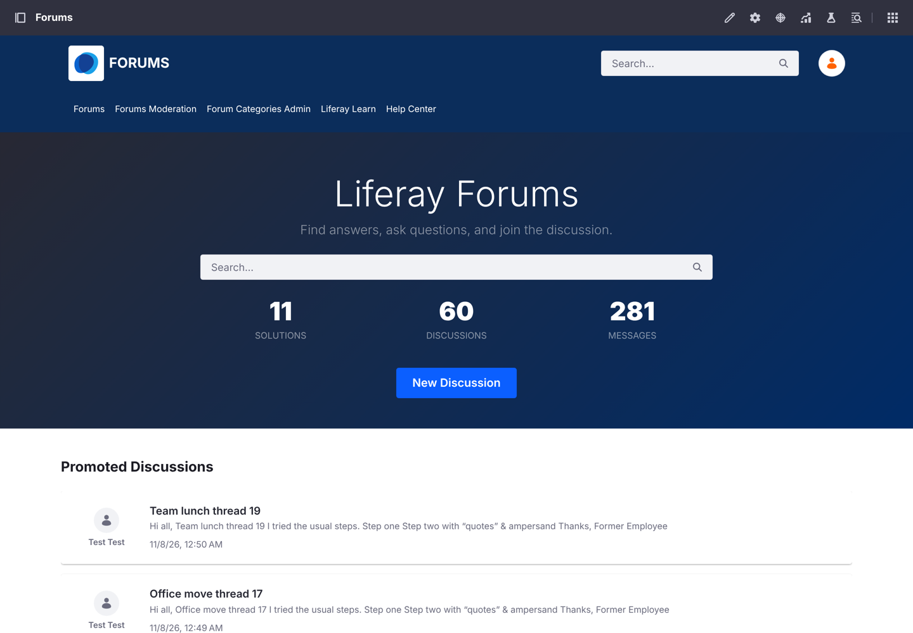
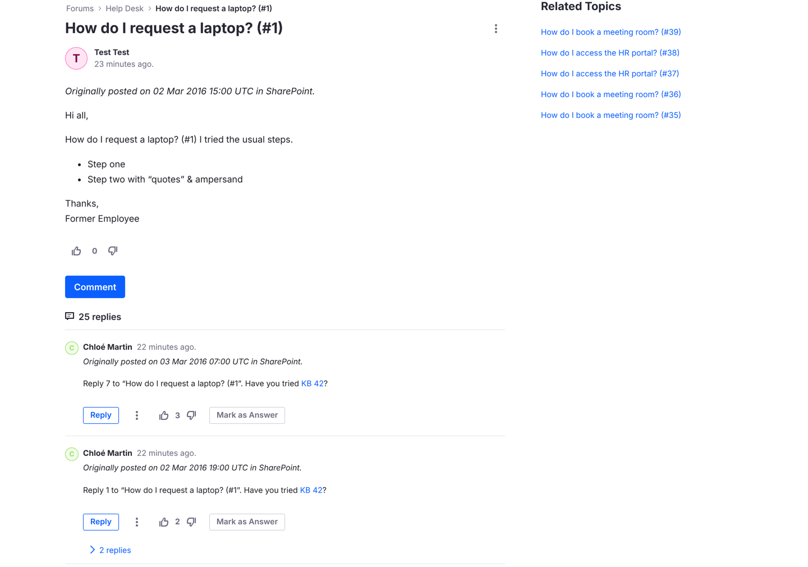

# SharePoint Discussions to Liferay Forums
{: .no_toc }

{: .important }
This recipe uses **Liferay Migration Studio**, which is coming soon. The recipe describes how the migration works so you can plan for it; you can follow it once Migration Studio is released.

1. TOC
{:toc}

## What You'll Build

Your SharePoint Server 2016 discussion boards, moved into a [Liferay Forums](/liferay-forums/) site: every discussion, reply and reply-to-a-reply, with its original author, best answer, attachments and likes. Each board becomes a forum category, and members carry on the conversations where they left off.

{: .screenshot }

## Ingredients

| Ingredient | Type | Guide |
| --- | --- | --- |
| Liferay Forums 1.0.0 | Marketplace App | [Liferay Forums guide](/liferay-forums/) |
| Liferay Migration Studio (coming soon) | Tool | [Liferay Migration Studio](https://github.com/Liferay-Community-APAC/liferay-migration-studio) |
| Batch import that keeps each record's creator | DXP feature | [Batch Engine API Basics: Importing Data](https://learn.liferay.com/w/dxp/integration/headless-apis/using-liferay-as-a-headless-platform/consuming-apis/batch-engine-api-basics-importing-data) |

**Before you start, you need:**

- Liferay DXP 2026.Q1 LTS with Liferay Forums 1.0.0 installed, its forum site created and its microservice running. The microservice checks every new message, so the migration can't post while it's down.
- A SharePoint Server 2016 account that can read the site with the discussion boards. SharePoint 2013 and 2019 use the same REST API, so they should work the same way, but they haven't been tested.
- A Liferay administrator account for the forum's Liferay.
- Docker, to run Migration Studio on a computer or server that can reach both SharePoint and Liferay.

## Steps

### Step 1: Set Up Liferay Forums

Install Liferay Forums, create the forum site and start its microservice, as the [Liferay Forums guide](/liferay-forums/) describes. Note the forum site's friendly URL (`forums` by default).

Then turn off email notifications on the forum's Liferay until the migration is done, so members who subscribe to a category aren't emailed about every migrated post.

### Step 2: Check Your SharePoint Users

Migration Studio creates a Liferay user for each SharePoint site user **with an email address**, and keeps them as the authors of their discussions, replies and likes. Users get no password: they sign in with your single sign-on, or reset their password.

Check SharePoint's site users before you start. Posts by someone without an email address, such as an account that left the company, are posted by the migration account instead, and the validation in Step 5 lists them.

### Step 3: Create the Migration Project

1. Start Migration Studio and open it in your browser.
1. Click **New project** and choose **SharePoint discussion boards → Liferay Forums**.
1. In **Connections**, enter:
    - **SharePoint:** the server's address, such as `https://sharepoint.example.com`. SharePoint Server on premises usually needs **NTLM** authentication, with the user as `DOMAIN\user`.
    - **Liferay:** the forum's Liferay address and the administrator account.

    Passwords are read from environment variables on the Migration Studio server, so they're never stored in the project.
1. In **Settings → Variables**, set `spSite` to the SharePoint site's path under `/sites/`, and `forumSiteKey` to the forum site's friendly URL from Step 1.
1. Click **Test connection** on each connection. The Liferay connection should show **Liferay DXP**.

### Step 4: Extract, Dry Run and Load

On the project's **Overview** page:

1. **Extract** reads the discussion boards, site users, discussions, replies, attachments and likes from SharePoint, and stages them.
1. **Dry run** shows every request the load would send to Liferay, without writing anything. Review it.
1. **Load** writes to the forum. Migration Studio works out the order: users and categories first, then discussions, their original posts and replies (each reply after the one it answers), then attachments, likes, and finally each discussion's last post date.

How SharePoint maps to Liferay Forums:

| SharePoint | Liferay Forums |
| --- | --- |
| Discussion board | Forum category |
| Discussion | Topic, with its original post |
| Reply, and reply to a reply | Message, nested under the message it answers |
| Best answer | The message marked as the answer |
| Attachment | Attachment on the post or reply |
| Like | A vote by the user who liked it |
| Site user with an email | Liferay user, kept as the author |
| Last updated | The topic's last post date |

Each post starts with *Originally posted on* and its SharePoint date, because Liferay sets a migrated post's own date to the time of the migration.

The load can be stopped and run again: every migrated record has a stable reference, so records already in the forum are updated, not duplicated.

### Step 5: Validate

Click **Validate**. Migration Studio checks:

- **Counts:** every discussion, reply, attachment and like was loaded.
- **A sample of migrated posts,** read back from Liferay and compared field by field with SharePoint, including the author.
- **Dependencies:** posts whose author wasn't migrated, for example *51 posts and replies by "Former Employee", a user without an email address*.

{: .screenshot }

## Result

Open the forum. Each SharePoint board is a category, and its discussions show their replies in the same tree as in SharePoint, with best answers marked and likes counted as votes. Sign in as a migrated member and check that their posts show them as the author.

**Tested:** Liferay Forums 1.0.0 on Liferay DXP 2026.Q1.4 LTS with PostgreSQL, against a simulated SharePoint Server 2016 REST API. It migrated 60 discussions, 281 messages nested up to three levels, 38 attachments and 308 likes, with no errors. Every post kept its author, except the 51 by a user without an email address. **Run a test migration from your own SharePoint farm into a test forum first.**

**Not migrated:**

- **Original dates as Liferay's own.** Lists show the migration date; each post's first line keeps the SharePoint date.
- **Users without an email address,** and their likes. Their posts are posted by the migration account.
- **Star ratings, Featured discussions, alerts and subscriptions.**

**Where next:**

- Turn email notifications back on, and tell members where the forum now lives.
- At cutover, start an extract from the **Runs** page with **Delta (changed since last extract)** checked, then **Load** again: only discussions changed since the first migration are read and written.
- [Forums Assistant with AI Hub](../forums-ai-assistant/), to help members find the migrated discussions.
